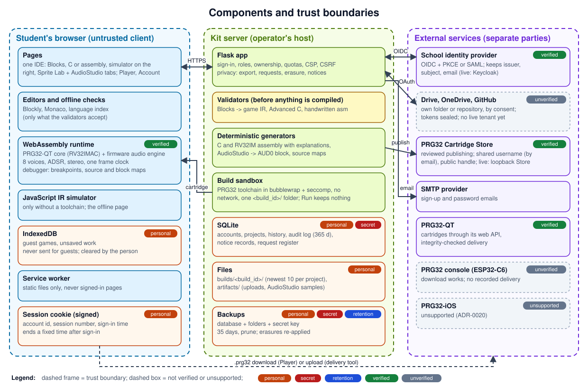
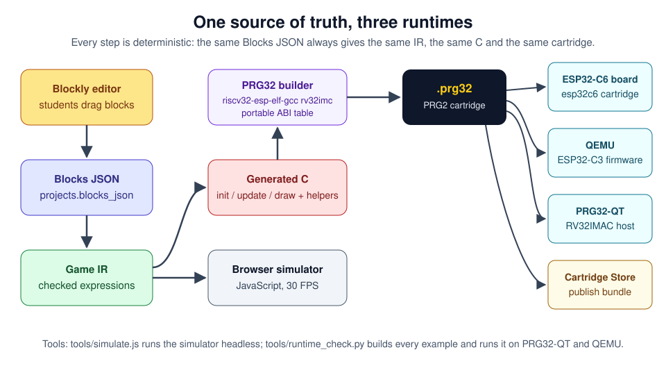
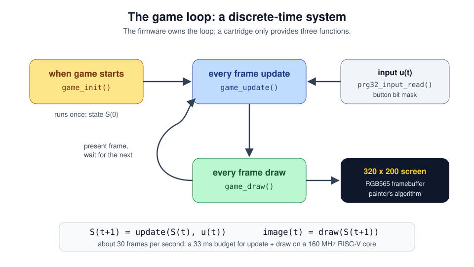
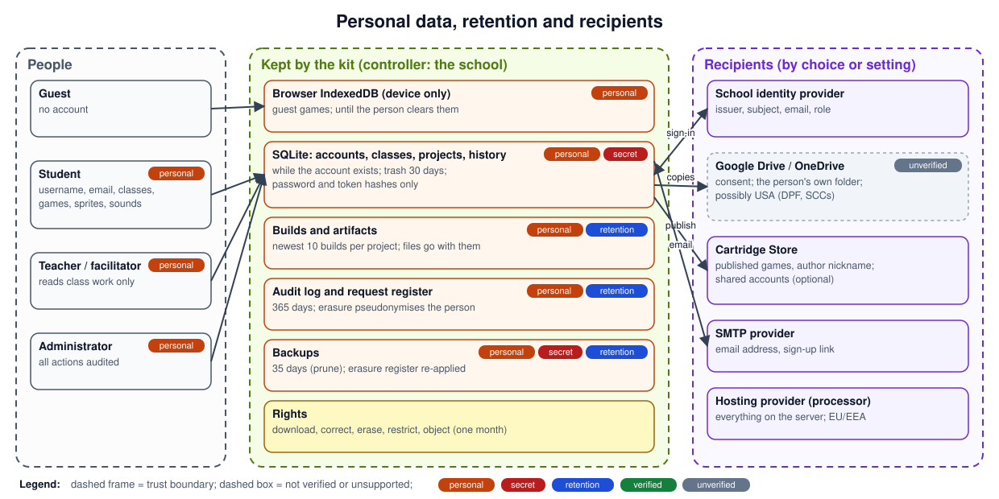

# Architecture

What the kit is made of, where its trust boundaries are, and where personal data goes. The
status of each capability (implemented, partial, missing), with its source and tests, is in
[capabilities.md](capabilities.md). The decisions behind the design are in [adr/](adr/README.md).

## Components and trust boundaries



| Zone | Component | Where in the code | Notes |
|---|---|---|---|
| **Browser** (untrusted) | Pages: IDE, Blocks editor, Player, Sprite Lab, AudioStudio, Account | `templates/`, `static/js/` | Bootstrap + jQuery; every library from `static/vendor/`; strict CSP (ADR-0012) |
| | Editors and offline checks | `static/js/ide/`, `static/js/ide/prg32_language_index.js` | Blockly, Monaco; suggest only what the validators accept (ADR-0014) |
| | WebAssembly runtime and debugger | `wasm/`, `static/wasm/`, `static/js/prg32_runtime.js`, `static/js/prg32_debugger.js` | PRG32-QT's core and the PRG32 firmware's audio engine (ADR-0021); source and block maps (ADR-0015) |
| | JavaScript IR simulator | `static/js/simulator.js` | the offline page's Blocks preview, and the IDE's fallback when the server cannot compile; Run and the Player use the WebAssembly core |
| | IndexedDB | `static/js/guest_store.js` | guest games and unsaved work, on the device only (ADR-0017) |
| | Service worker | `/service-worker.js` | static files only, never signed-in pages |
| **Kit server** (the operator's host) | Flask app, session, roles | `prg32_construction_kit/auth.py`, `routes.py`, `classes.py` | signed session cookie; ownership; quotas; `X-PRG32-Kit` and `X-PRG32-User` checks |
| | Privacy | `prg32_construction_kit/privacy.py` | export, request register, restriction, erasure, notices (ADR-0022) |
| | Validators | `generator.py`, `expressions.py`, `source_project.py` | nothing a validator refuses is ever compiled; never C an AI suggests |
| | Generators | `generator.py`, `asm_generator.py`, `audio_block.py`, `source_maps.py` | deterministic C and RV32IM assembly with explanations; AUD0 audio block |
| | Build sandbox | `packager.py`, `build_sandbox.py`, `build_guard.py`, `build_budget.py` | bubblewrap + seccomp, no network, one `<build_id>/` folder per build, disk budgets |
| | SQLite | `db.py` and every model | accounts, projects and history, audit log, privacy records |
| | Files | `BUILD_ROOT`, `ARTIFACT_ROOT` | build folders, uploads, AudioStudio samples |
| | Backups | `tools/backup_restore.py` | database, folders, secret key; pruned after 35 days |
| **External** (separate parties) | School identity provider | `identity.py`, `auth_adapters.py` | OIDC with PKCE, or SAML; accounts keyed by issuer + subject (ADR-0016) |
| | Google Drive, OneDrive | `cloud_storage.py` | the person's own app folder, by consent; tokens encrypted (ADR-0019) |
| | Cartridge Store | `publisher.py`, `publishing.py`, `sso.py`, `store_contract.py` | reviewed publishing; optional shared accounts (ADR-0018) |
| | SMTP | `auth.py` | sign-up and password emails |
| | PRG32-QT, PRG32 console, PRG32-iOS | `tools/delivery_check.py` | PRG32-QT verified through its web API; console not verified; iOS unsupported (ADR-0020) |

**Not supported or not verified:**

- PRG32-iOS: unsupported (ADR-0020);
- delivery to a physical PRG32 console: no recorded run;
- real Google, Microsoft or school tenants: no run (the live suites are ready,
  [live_testing.md](live_testing.md));
- the PRG32-QT desktop Import menu driven by a person.

Threat model and controls: [security.md](security.md) and
[privacy/security_article32.md](privacy/security_article32.md).

## From source to cartridge



1. **Authoring.** Each kind of project is saved where it belongs:
   - Blocks: the Blockly workspace exactly as JSON, in `projects.blocks_json`;
   - Advanced C: `game_json.source_c`;
   - handwritten assembly: `game_json.source_asm`;
   - AudioStudio: one versioned asset per project.
2. **Validation, before anything is compiled:**
   - Blocks become the validated game IR (below);
   - C passes the include and ABI checks;
   - assembly passes the directive allow-list and the lifecycle labels
     ([handwritten_assembly.md](handwritten_assembly.md)).
3. **Generation.** It is deterministic, so the same saved project always gives the same
   result:
   - C, and on request RV32IM assembly that does exactly what the C does, each with its
     per-block and per-line comments ([generated_code.md](generated_code.md));
   - the AUD0 audio block;
   - source maps that leave the generated code unchanged.
4. **Build.** The PRG32 toolchain runs in the sandbox, in a private `<build_id>/` folder
   ([build_sandbox.md](build_sandbox.md), [concurrent_builds.md](concurrent_builds.md)).
   - A debug build adds `-g` only, and its cartridge is byte-identical
     ([build_provenance.md](build_provenance.md)).
   - Provenance records the kit, SDK, ABI and compiler, and the SHA-256 of every file.
5. **Run, deliver, publish:**
   - the browser runtime and its debugger ([wasm_runtime.md](wasm_runtime.md));
   - PRG32-QT, QEMU or a console ([delivery.md](delivery.md),
     [runtime_check.md](runtime_check.md));
   - a reviewed bundle to the Cartridge Store
     ([cartridge_store_publish.md](cartridge_store_publish.md)).

Without the toolchain, **Compile** stores a source bundle: generated C, project,
IR and manifest.

## The game loop and the frame clock



The firmware owns the loop. A cartridge provides three functions:

- `<prefix>_init`, called once;
- `<prefix>_update` and `<prefix>_draw`, called about 30 times a second.

Audio calls made during frame N take effect at N × 33 ms. The engine renders 20 ms buffers,
so a sound always starts in the same buffer: in the browser, in PRG32-QT and in QEMU
(ADR-0021).

## Personal data and retention



| Data | Where | Kept for | Who receives it |
|---|---|---|---|
| Guest games | the browser (IndexedDB) | until the person clears it | nobody |
| Account, classes, projects, history | SQLite | while the account exists; trash 30 days | the Cartridge Store with shared accounts |
| Builds and files | `builds/`, `artifacts/` | newest 10 builds per project | nobody |
| Audit log | SQLite | 365 days; pseudonymised on erasure | nobody |
| Cloud tokens (encrypted) | SQLite | until disconnected | Google or Microsoft, by the person's choice |
| Backups | chosen by the operator | 35 days | the hosting provider |

**Secrets:**

- password and token hashes;
- encrypted cloud tokens;
- the secret key (in backups);
- Store bearer tokens, encrypted at rest and read back only to send them to the Store.

The complete field-level record, the legal bases, rights and transfers are in
[privacy/](privacy/README.md).

## Persistence

All CRUD operations use SQLAlchemy models. SQLite is selected automatically for local and
classroom installations. `DATABASE_URL` can select any supported SQLAlchemy database;
PostgreSQL with the `psycopg` driver is recommended for production concurrency. JSON-shaped
fields stay JSON text columns, so the API format and the SQLite schema stay compatible.
Initialisation is idempotent (`CREATE TABLE IF NOT EXISTS` plus small column migrations).

SQLite connections use foreign-key enforcement, WAL mode and a busy timeout. These help small
classroom concurrency, but they do not turn SQLite into a multi-server database.

The CRUD resources are projects, sprites, assets, artifacts, builds and publish profiles
([api.md](api.md)). Accounts, classes, identities, cloud links, publishing attempts, the
audit log and the privacy records have their own tables.

## Why an intermediate representation?

The IR lets the web app and the backend agree on what a game means, without treating C as
the only source of truth:

```text
block: if left pressed -> change player_x by -3
IR:    {op: "if_button", button: "LEFT", then: [...]}
C:     if (input & PRG32_BTN_LEFT) { player_x += -3; }
JS:    if (keys.LEFT) { state.player_x += -3; }
```

## Game IR 1.1

The IR (`prg32-construction-kit-game-1.1`) lists the game's variables, lists, required PRG32
features and three statement lists. Statements are small JSON objects (`set`, `if`,
`repeat`, `list_set`, `line`, `playfield_put`, ...) whose expression fields are already
checked and normalised. Python (`generator.py`) and JavaScript (`simulator.js`) build the
same IR from the same Blocks JSON. The tests compare them for every example, and for one
block of every toolbox type.

The generated C is freestanding: no libc, no floating point, no dynamic memory.

- Lists are `static int` arrays, accessed through bounds-checked helpers.
- `repeat` loops have a hidden counter, capped at 1024 iterations.
- Integer division follows the RISC-V rules (no trap on division by zero), in both the C and
  the simulator. Division by anything other than a fixed number goes through the
  `prg32_kit_div` / `prg32_kit_mod` helpers, so the C never relies on undefined behaviour.
- Helpers are emitted only when the game uses them, so the generated C compiles cleanly with
  `-Wall -Wextra`.

Artifact downloads and publishing read only files inside `BUILD_ROOT` and `ARTIFACT_ROOT`,
and never the database or the secret key, even if an artifact row points at them.

## Keeping this page true

The diagrams are drawn by `tools/build_diagrams.py`, and every picture is listed in
`figures/manifest.json`. `tools/check_docs.py` (in CI) checks:

- links and alt text;
- that diagrams and screenshots are up to date;
- the settings, routes and ABI versions named here;
- ADR and capability IDs.

What a person checks before a release: [release_checklist.md](release_checklist.md).
