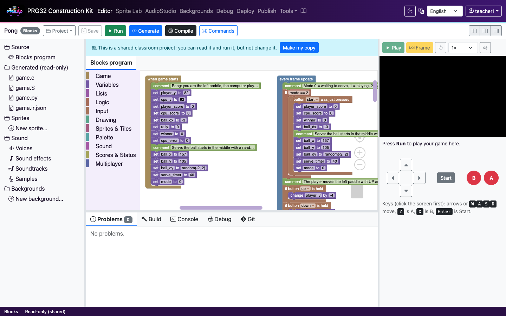
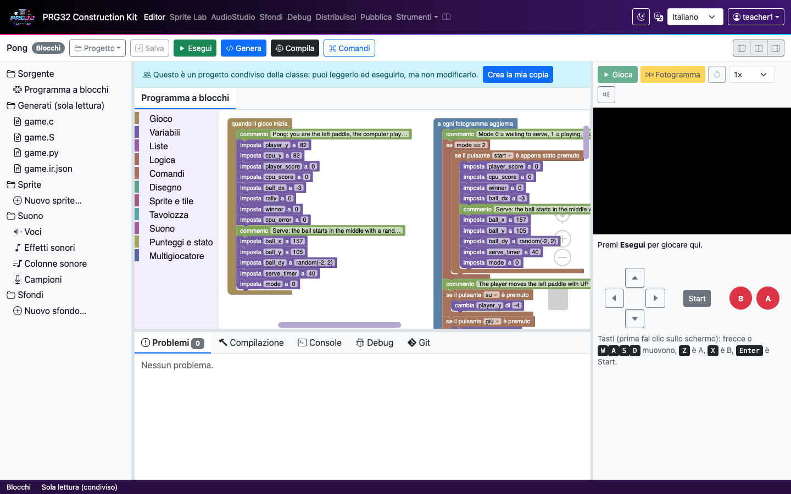
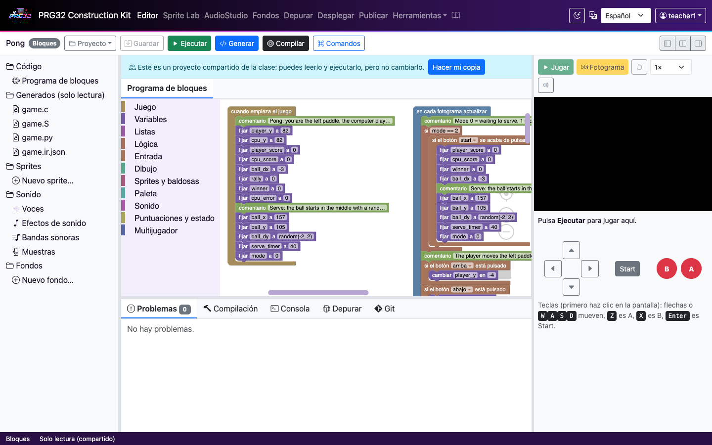
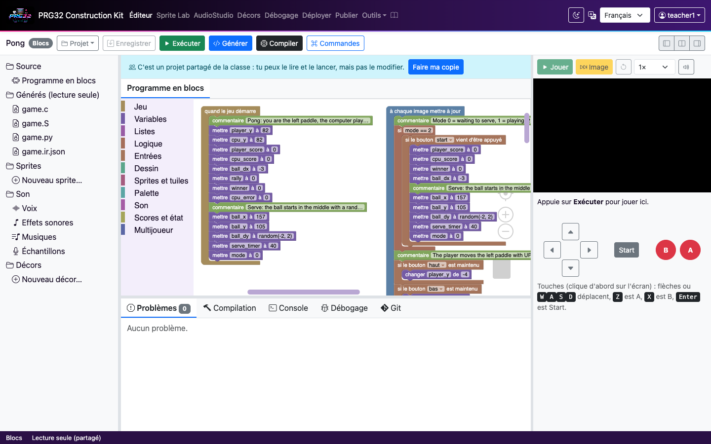
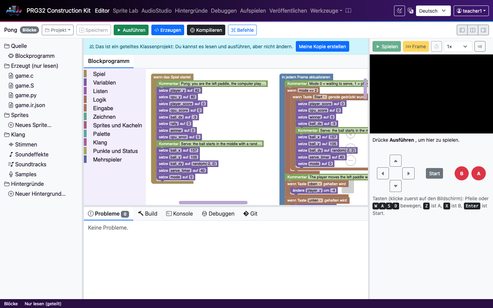
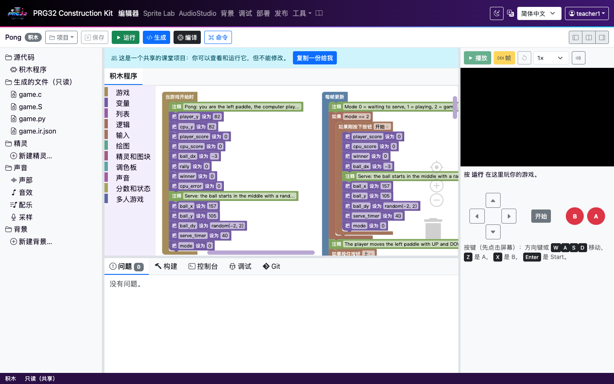

# Languages of the kit

The kit's pages, menus, editors, debugger, Sprite Lab, AudioStudio, sign-in, privacy pages and
messages are available in **English, Italiano, Español, Français, Deutsch and 简体中文
(Simplified Chinese)**. Design:
[ADR-0027](adr/0027-interface-languages.md).

## For students and teachers

- Choose the language with the menu in the top bar (the globe-like *translate* icon). The page
  reloads in that language; unsaved work in the IDE is saved first.
- Without a choice, the kit uses your browser's language when it is one of the six, else English.
  Chinese in Simplified characters (`zh`, `zh-CN`, `zh-SG`, `zh-Hans`) gets 简体中文; Chinese in
  Traditional characters (`zh-TW`, `zh-HK`, `zh-Hant`) gets English rather than the wrong script.
- The choice is kept in a cookie (`prg32_locale`) and in this browser, so it also works on the
  offline page. It says nothing else about you (see [/privacy#storage](/privacy#storage)).
- **Your projects do not change with the language.** The C and assembly the kit writes, and the
  cartridges it builds, are exactly the same in every language. Their teaching comments are in
  English, so a class working in several languages compares the same files.
- Quick start in your language: [English](tutorials/quickstart.en.md) ·
  [Italiano](tutorials/quickstart.it.md) · [Español](tutorials/quickstart.es.md) ·
  [Français](tutorials/quickstart.fr.md) · [Deutsch](tutorials/quickstart.de.md) · [简体中文](tutorials/quickstart.zh-Hans.md).

## The IDE in every language

Synthetic screenshots (`python3 tools/capture_visuals.py ide-<language>`, sample project Pong):

- English: 
- Italiano: 
- Español: 
- Français: 
- Deutsch: 
- 简体中文: 

## The lessons in every language

The classroom lessons (`docs/tutorials/`) are in all six languages: `<lesson>.md` is English,
`<lesson>.<language>.md` the same lesson translated, with the same sections and exactly the same code
(`tests/test_doc_translations.py`). Button and block names are the ones each language shows on screen.

| Lesson | English | Italiano | Español | Français | Deutsch | 简体中文 |
| --- | --- | --- | --- | --- | --- | --- |
| Tutorial 1: First Blocks Project | [en](tutorials/01_first_project.md) | [it](tutorials/01_first_project.it.md) | [es](tutorials/01_first_project.es.md) | [fr](tutorials/01_first_project.fr.md) | [de](tutorials/01_first_project.de.md) | [zh-Hans](tutorials/01_first_project.zh-Hans.md) |
| Tutorial 2: Make a Catch Game | [en](tutorials/02_catch_game.md) | [it](tutorials/02_catch_game.it.md) | [es](tutorials/02_catch_game.es.md) | [fr](tutorials/02_catch_game.fr.md) | [de](tutorials/02_catch_game.de.md) | [zh-Hans](tutorials/02_catch_game.zh-Hans.md) |
| Tutorial 3: Draw and Convert a Sprite | [en](tutorials/03_sprite_editor.md) | [it](tutorials/03_sprite_editor.it.md) | [es](tutorials/03_sprite_editor.es.md) | [fr](tutorials/03_sprite_editor.fr.md) | [de](tutorials/03_sprite_editor.de.md) | [zh-Hans](tutorials/03_sprite_editor.zh-Hans.md) |
| Tutorial 4: Prepare and Publish a Cartridge Bundle | [en](tutorials/04_publish_to_store.md) | [it](tutorials/04_publish_to_store.it.md) | [es](tutorials/04_publish_to_store.es.md) | [fr](tutorials/04_publish_to_store.fr.md) | [de](tutorials/04_publish_to_store.de.md) | [zh-Hans](tutorials/04_publish_to_store.zh-Hans.md) |
| Tutorial 5: Teacher Lab Flow | [en](tutorials/05_teacher_lab.md) | [it](tutorials/05_teacher_lab.it.md) | [es](tutorials/05_teacher_lab.es.md) | [fr](tutorials/05_teacher_lab.fr.md) | [de](tutorials/05_teacher_lab.de.md) | [zh-Hans](tutorials/05_teacher_lab.zh-Hans.md) |
| Tutorial 6: Classic Games | [en](tutorials/06_classic_games.md) | [it](tutorials/06_classic_games.it.md) | [es](tutorials/06_classic_games.es.md) | [fr](tutorials/06_classic_games.fr.md) | [de](tutorials/06_classic_games.de.md) | [zh-Hans](tutorials/06_classic_games.zh-Hans.md) |
| Lesson 7: Look inside the processor with the debugger | [en](tutorials/07_debugger.md) | [it](tutorials/07_debugger.it.md) | [es](tutorials/07_debugger.es.md) | [fr](tutorials/07_debugger.fr.md) | [de](tutorials/07_debugger.de.md) | [zh-Hans](tutorials/07_debugger.zh-Hans.md) |
| Tutorial 8: sound effects and music with AudioStudio | [en](tutorials/08_audio_studio.md) | [it](tutorials/08_audio_studio.it.md) | [es](tutorials/08_audio_studio.es.md) | [fr](tutorials/08_audio_studio.fr.md) | [de](tutorials/08_audio_studio.de.md) | [zh-Hans](tutorials/08_audio_studio.zh-Hans.md) |
| Tutorial 9: your first game in PRG32 Python | [en](tutorials/09_python.md) | [it](tutorials/09_python.it.md) | [es](tutorials/09_python.es.md) | [fr](tutorials/09_python.fr.md) | [de](tutorials/09_python.de.md) | [zh-Hans](tutorials/09_python.zh-Hans.md) |

## What is translated

| Part | Translated | Notes |
| --- | --- | --- |
| Every page, menu, dialog, tab, button, label, tooltip and screen-reader label | yes | server pages through `t()`, scripts through `tr()` |
| Blocks (block text, dropdowns, tooltips) | yes | the kit's own blocks |
| Blockly's own menus (right-click: Duplicate, Delete Block, Undo...) and Monaco's own widgets (Find, its command list) | yes | their own language packs, vendored with the libraries (`static/vendor/blockly/11.2.1/msg/`, Monaco's `nls.messages.*.js`) |
| Chinese characters | yes | the computer's CJK font, else Noto Sans SC from the kit (`static/vendor/@fontsource/noto-sans-sc`, fetched piece by piece for the characters on a page); lines break between characters, not inside code |
| IDE live checks and the explanation under each problem (C, assembly, PRG32 Python) | yes | |
| Debugger, Player, Sprite Lab, AudioStudio, publishing, cloud, classes, account, admin pages | yes | |
| Offline page and offline player | yes | `data-i18n`, cached by the service worker |
| Privacy notice summaries | yes | one version per notice, six languages |
| Generated C and assembly comments | **no, on purpose** | build outputs must be the same in every language |
| Messages the server writes: the PRG32 Python checker's refusals, the C and assembly validators, AudioStudio, build, run, storage, project, publishing, account, admin, class, sign-in (school, single sign-on), privacy-request and settings answers, and the server's own sign-in, registration and error pages | yes | each is an English template with a stable key (`messages.py`); the answer carries the key and its values, the browser shows the reader's language, the English is the fallback |
| Compiler logs | no | GCC's own words, shown as sent; the kit's explanation under each problem is translated |
| Machine codes in answers (`not_signed_in`, `quota_exceeded`, ...) | **no, on purpose** | codes for programs, not sentences; the sentence next to each is translated |
| Long-form documentation in `docs/` | the quick start and the nine classroom lessons in all six languages; the reference guides (ADRs, administration, security, privacy records) in English | |

## For developers

- A message the server writes for people: `say("area", "Template with {name}", name=value)`
  (`prg32_construction_kit/messages.py`). It is a `str` with the English filled in, plus its key
  (`server.<area>.<first words>_<hash>`) and values; `json_error` and the other answers add
  `message_key` and `params`. Put the template under its key in every catalog
  (`tests/test_messages.py` lists any that are missing).

- Catalogs: `static/i18n/<locale>.json` (flat `key -> text`; `{name}` placeholders; `.one`/`.other`
  plural pairs). After a change run `python3 tools/build_i18n.py` (writes the `.js` copies; CI
  checks they are current).
- Templates: `{{ t("page.key") }}`, with values `{{ t("page.key", name=value) }}`; the output is
  escaped by Jinja.
- Scripts: `tr('js.file.key', 'English text with {name}', { name })`. Escape with `Kit.escape`
  when the result goes into HTML.
- Static pages: `data-i18n="key"` and `data-i18n-attr="title:key;aria-label:key"`.
- Keys are named `<page>.<words>` (`common.` for text on several pages, `js.<script>.` for scripts).
- `tests/test_i18n.py` fails on: a missing or extra key, different placeholders, an empty message,
  a message equal to English that is not in the reviewed list
  (`tests/fixtures/i18n/same_as_english.json`), an unused key, text in a template outside `t()`,
  HTML text in a script outside `tr()`, catalogs missing from the service worker, and any
  difference in generated code or cartridges between languages.
