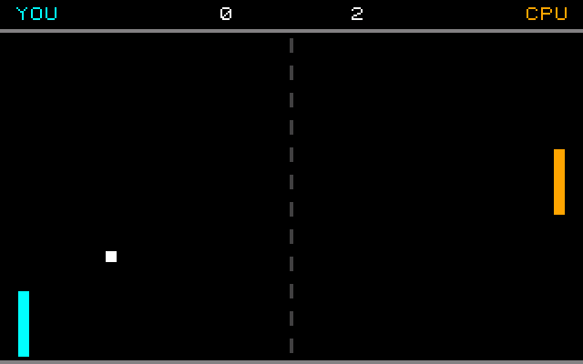
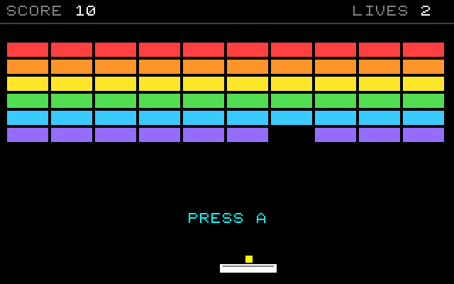
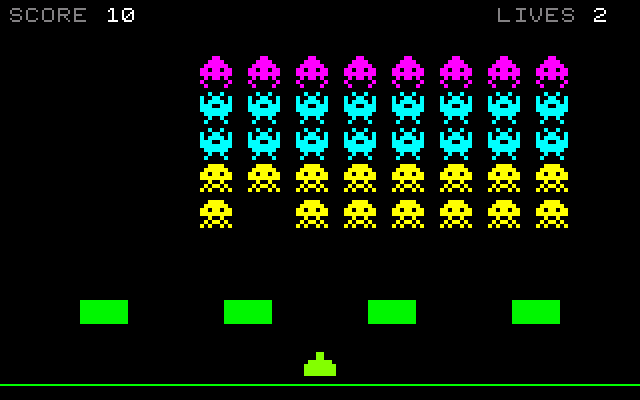
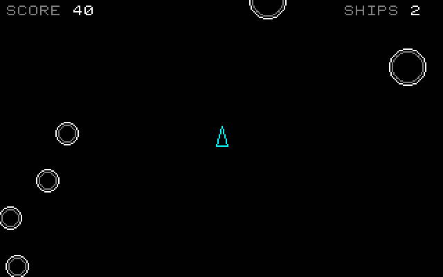
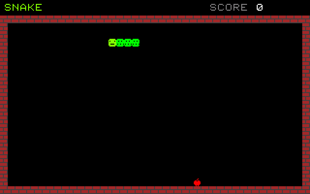
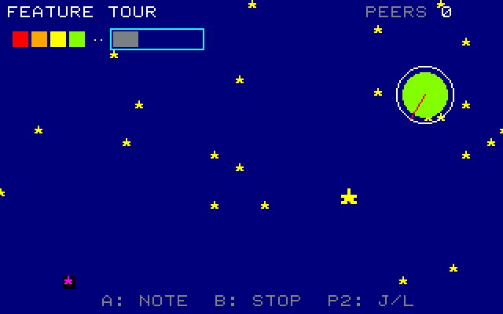
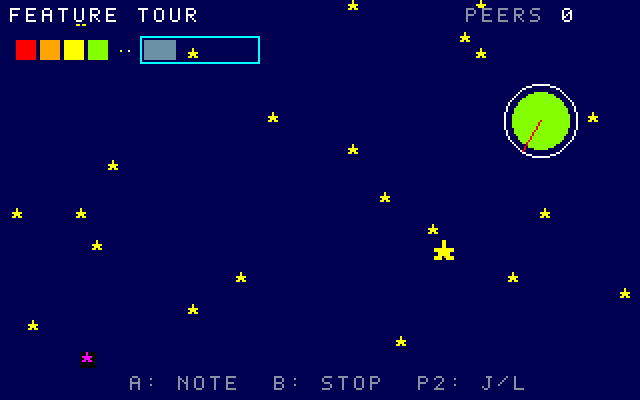
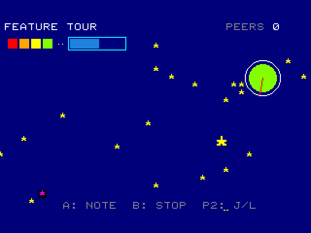

# Classic games with PRG32 Blocks

Five complete, playable games built **only from blocks**. Each one comes with a
step-by-step tutorial that is both a handout (read it here) and a slide deck
(open the HTML version and press the arrow keys, or `F` for full screen).

| Game | Main ideas | Tutorial | Slides |
| --- | --- | --- | --- |
| Pong | game loop, velocity, AABB collision, a feedback-controlled opponent | [pong.md](pong.md) | [pong.html](../../presentations/pong.html) |
| Breakout | lists as memory, index arithmetic, aiming, lives | [breakout.md](breakout.md) | [breakout.html](../../presentations/breakout.html) |
| Space Invaders | 8 x 8 pictures as bytes, a marching fleet, object pools | [space_invaders.md](space_invaders.md) | [space_invaders.html](../../presentations/space_invaders.html) |
| Asteroids | fixed point, integer sin/cos, inertia, torus wrap, circle tests | [asteroids.md](asteroids.md) | [asteroids.html](../../presentations/asteroids.html) |
| Snake | tiles and playfields, ring buffer, timing separate from input | [snake.md](snake.md) | [snake.html](../../presentations/snake.html) |

Suggested order: Pong, Breakout, Space Invaders, Asteroids, Snake. Each deck
takes 90-120 minutes in class, including the exercises.

When the kit is running, the decks are also served at
`http://<kit>/docs/presentations/pong.html` (and so on). Print them to PDF
from the browser: each slide becomes one page.

## Open a game in the editor

Dashboard, **Examples**, choose an entry marked **complete game**, **Add**.
The project is an ordinary copy: change it freely. The original files are in
`examples/games/*.json` and can also be imported with **Import JSON**.

## Every game runs everywhere

Each game was checked through the whole pipeline with
`tools/runtime_check.py`:

| Game | Generated C | RISC-V code | PRG32 features | Simulator | QEMU firmware | PRG32-QT |
| --- | --- | --- | --- | --- | --- | --- |
| Pong | 349 lines | 4644 bytes | audio, sprites | yes | yes | yes |
| Breakout | 345 lines | 4784 bytes | audio, sprites | yes | yes | yes |
| Space Invaders | 566 lines | 6420 bytes | audio, sprites | yes | yes | yes |
| Asteroids | 629 lines | 9308 bytes | audio | yes | yes | yes |
| Snake | 446 lines | 5120 bytes | audio, tilemap | yes | yes | yes |

The same cartridge code is built for `esp32c6` (the PRG32 board) and `qemu`.
See [../../runtime_check.md](../../runtime_check.md) to repeat the checks.

### The same frame on three runtimes

The last frame of each scripted run, from `tools/runtime_check.py --figures` (recipes and
dates: `docs/figures/manifest.json`). The simulator draws 320 x 200; QEMU's frame buffer
is 320 x 240, so its pictures have a black band at the bottom.

| Game | Construction Kit simulator | PRG32-QT | PRG32 firmware in QEMU |
|---|---|---|---|
| Pong |  |  |  |
| Breakout |  |  |  |
| Space Invaders |  |  |  |
| Asteroids |  |  |  |
| Snake |  |  |  |
| Feature tour |  |  |  |

## For maintainers

- The games are written in `tools/build_example_games.py`, a small Python
  vocabulary that mirrors the blocks. Run `python3 tools/build_example_games.py`
  after editing it.
- Block listings and C excerpts in the tutorials are generated: run
  `python3 tools/build_presentations.py` after changing a game or a tutorial.
  The test suite fails when either is out of date.

*These are original, classic-inspired reimplementations made for teaching;
they are not affiliated with the historical products or their owners.*
