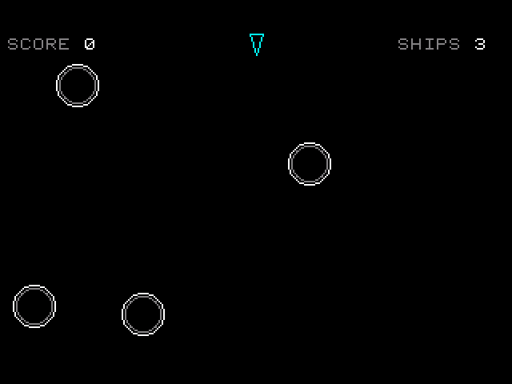
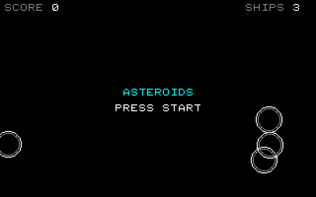
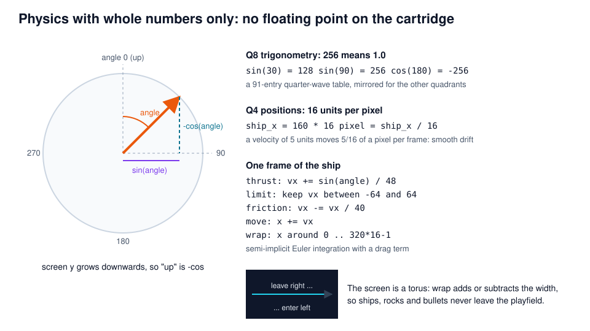
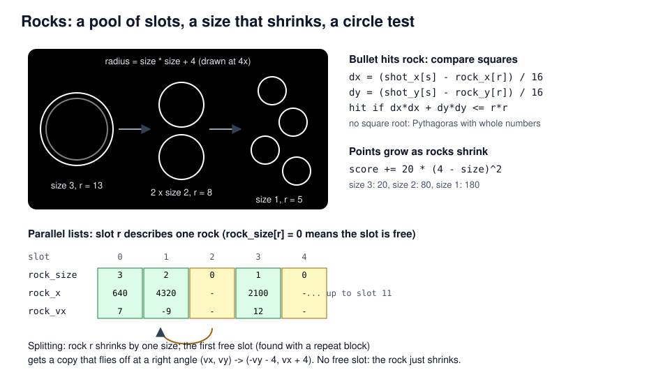
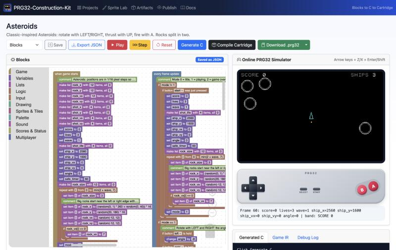
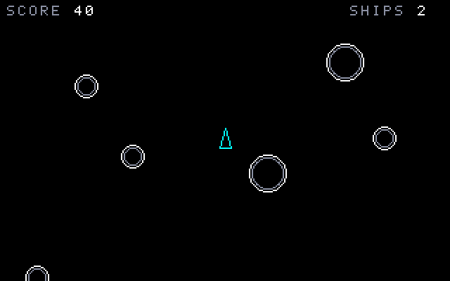

<!-- class: title -->
# Asteroids
## Physics without floating point: angles, inertia and a wrap-around universe

PRG32-Construction-Kit tutorial deck, step by step, from blocks to a RISC-V cartridge.



---

## Learning outcomes

1. represent fractions with **fixed-point integers** (Q4 positions, Q8 trigonometry);
2. turn an angle into a direction with **integer sine and cosine**;
3. simulate **inertia, thrust and drag** with semi-implicit Euler integration;
4. use a **torus topology**: objects leaving one edge enter on the other;
5. test circle collisions with **squared distances** and manage objects in **slot pools**.

**Prerequisites:** Pong and Space Invaders tutorials. About 2 hours.

---

## Context

- Atari's **Asteroids** (1979, Lyle Rains and Ed Logg) drew with a **vector display**: the electron beam traced lines instead of scanning a raster.
- Its ship obeyed Newton's first law: no brakes, only rotation and thrust. Players had to think in **velocities**, not positions.
- On a 320 x 200 raster screen we draw the same look with **Bresenham lines** and **midpoint circles**, two classic integer algorithms the kit writes into the generated C.

> The ESP32-C6 core has no floating-point unit. Fixed-point arithmetic gives smooth motion with whole numbers only.

*Original, classic-inspired reimplementation for teaching; not affiliated with the historical products.*

---

## Rules and controls

<!-- column -->

| Button | Action |
| --- | --- |
| LEFT / RIGHT | rotate the ship |
| UP | thrust |
| A | fire (up to 4 bullets) |
| START | start / play again |

- Big rocks split into two medium rocks, medium into two small ones.
- Smaller rocks give more points: 20, 80, 180.
- After losing a ship you are safe (blinking) for two seconds.
- Clearing all rocks starts a bigger wave.

<!-- column -->



---

## Whole-number physics



---

## Step 1 - Lists for rocks and bullets

<!-- column -->

<!-- blocks: asteroids start "Asteroids:" -->
```text
comment Asteroids: positions are in 1/16 pixel steps so the ship can drift smoothly.
make list rock_x with 12 items, all 0
make list rock_y with 12 items, all 0
make list rock_vx with 12 items, all 0
make list rock_vy with 12 items, all 0
make list shot_x with 4 items, all 0
make list shot_y with 4 items, all 0
make list shot_vx with 4 items, all 0
make list shot_vy with 4 items, all 0
```
<!-- /blocks -->

<!-- column -->

- 12 rock slots and 4 bullet slots, each described by **parallel lists** (`rock_x[r]`, `rock_vx[r]`, ...).
- A slot is free when `rock_size[r] == 0` or `shot_life[s] == 0`.
- Positions are stored **x 16**: `ship_x = 160 * 16` is the centre of the screen.

---

## Step 2 - Rotation and thrust

<!-- column -->

<!-- blocks: asteroids update "Rotate with LEFT" -->
```text
comment Rotate with LEFT and RIGHT: the angle is in degrees, 0 points up.
if button left is held
    change angle by -8
if button right is held
    change angle by 8
wrap angle around 0 to 359
```
<!-- /blocks -->

<!-- blocks: asteroids update "Thrust" -->
```text
comment Thrust: sin and cos give the direction, 256 means 1.0.
if button up is held
    change ship_vx by sin(angle) / 48
    change ship_vy by -cos(angle) / 48
```
<!-- /blocks -->

<!-- column -->

- `angle` is in degrees; *wrap* keeps it in 0..359.
- `sin(angle)` is between -256 and 256. Divided by 48 it adds at most 5/16 of a pixel per frame to the velocity: a gentle **acceleration**.
- Screen y grows downwards, so "forward" is `-cos(angle)`.

---

## Step 3 - Drag, speed limit, wrap-around

<!-- column -->

<!-- blocks: asteroids update "Speed limit" -->
```text
comment Speed limit and friction, then move and wrap around the screen.
keep ship_vx between -64 and 64
keep ship_vy between -64 and 64
change ship_vx by -ship_vx / 40
change ship_vy by -ship_vy / 40
change ship_x by ship_vx
change ship_y by ship_vy
wrap ship_x around 0 to 5119
wrap ship_y around 0 to 3199
if safe_timer > 0
    change safe_timer by -1
```
<!-- /blocks -->

<!-- column -->

1. **Limit:** at most 64/16 = 4 pixels per frame.
2. **Drag:** lose 1/40 of the speed each frame (an exponential decay).
3. **Integrate:** position += velocity.
4. **Wrap:** leave right, enter left; the screen is a torus.

<!-- c: asteroids "Speed limit" -->
```c
/* Speed limit and friction, then move and wrap around the screen. */
if (ship_vx < -64) { ship_vx = -64; }
if (ship_vx > 64) { ship_vx = 64; }
if (ship_vy < -64) { ship_vy = -64; }
if (ship_vy > 64) { ship_vy = 64; }
ship_vx += -ship_vx / 40;
ship_vy += -ship_vy / 40;
ship_x += ship_vx;
ship_y += ship_vy;
if (ship_x < 0) { ship_x += (5119) - (0) + 1; }
else if (ship_x > 5119) { ship_x -= (5119) - (0) + 1; }
if (ship_y < 0) { ship_y += (3199) - (0) + 1; }
else if (ship_y > 3199) { ship_y -= (3199) - (0) + 1; }
if (safe_timer > 0) {
    safe_timer += -1;
}
```
<!-- /c -->

---

## Step 4 - Firing from a bullet pool

<!-- class: tight -->

<!-- column -->

<!-- blocks: asteroids update "Fire" -->
```text
comment Fire: find a free bullet slot (up to 4 bullets).
if button a was just pressed
    set free to -1
    repeat with j from 0 to 3
        if free < 0 && shot_life[j] == 0
            set free to j
    if free >= 0
        set item free of shot_life to 36
        set item free of shot_x to ship_x + sin(angle) * 8 * 16 / 256
        set item free of shot_y to ship_y - cos(angle) * 8 * 16 / 256
        set item free of shot_vx to ship_vx + sin(angle) * 3 / 8
        set item free of shot_vy to ship_vy - cos(angle) * 3 / 8
        play beep freq 1400 ms 20
```
<!-- /blocks -->

<!-- column -->

<!-- blocks: asteroids update "Bullets fly" depth 2 -->
```text
comment Bullets fly for 36 frames and wrap around the screen.
repeat with s from 0 to 3
    if shot_life[s] > 0
        ...
```
<!-- /blocks -->

A bullet starts at the nose (8 px ahead) and moves 6 px per frame **plus** the ship's velocity: Galilean relativity in two blocks.

---

## Step 5 - Rocks and collisions

<!-- blocks: asteroids update "Rocks drift" depth 2 -->
```text
comment Rocks drift and wrap; count how many are left.
set rocks_left to 0
repeat with r from 0 to 11
    if rock_size[r] > 0
        ...
```
<!-- /blocks -->

---

## Step 5 - Circles without square roots

<!-- class: tight -->

<!-- column -->

<!-- blocks: asteroids update "Bullet hits" depth 3 -->
```text
comment Bullet hits: compare squared distances, no square root needed.
repeat with s from 0 to 3
    if shot_life[s] > 0 && rock_size[r] > 0
        set dx to (shot_x[s] - rock_x[r]) / 16
        set dy to (shot_y[s] - rock_y[r]) / 16
        if dx * dx + dy * dy <= radius * radius
            ...
```
<!-- /blocks -->

<!-- column -->

A point is inside a circle when `dx*dx + dy*dy <= r*r`. Comparing **squares** avoids the square root, which a microcontroller would compute slowly.

Distances are divided by 16 first, so the squares stay small and cannot overflow a 32-bit `int`.

---

## Rocks split in two



---

## Step 6 - The split, in blocks

<!-- class: tight -->

<!-- blocks: asteroids update "Split" depth 3 -->
```text
comment Split: smaller rocks give more points, then the rock becomes one size smaller.
set score to score + 20 * (4 - rock_size[r]) * (4 - rock_size[r])
change item r of rock_size by -1
play MIDI note 50 + rock_size[r] * 6 on channel 1 for 120 ms
if rock_size[r] > 0
    comment Find a free slot for the second half of the rock.
    set free to -1
    repeat with j from 0 to 11
        if free < 0 && rock_size[j] == 0
            ...
    if free >= 0
        set item free of rock_size to rock_size[r]
        set item free of rock_x to rock_x[r]
        set item free of rock_y to rock_y[r]
        set item free of rock_vx to -rock_vy[r] - 4
        set item free of rock_vy to rock_vx[r] + 4
        set item r of rock_vx to rock_vy[r] + 4
        set item r of rock_vy to -rock_vx[free] - 4
```
<!-- /blocks -->

---

## Step 7 - Losing a ship, next wave

<!-- column -->

<!-- blocks: asteroids update "Ship collision" -->
```text
comment Ship collision: the ship counts as a circle of radius 4.
if mode == 1 && safe_timer == 0 && rock_size[r] > 0
    set dx to (ship_x - rock_x[r]) / 16
    set dy to (ship_y - rock_y[r]) / 16
    if dx * dx + dy * dy <= (radius + 4) * (radius + 4)
        change lives by -1
        play MIDI note 30 on channel 1 for 600 ms
        if lives > 0
            set ship_x to 2560
            set ship_y to 1600
            set ship_vx to 0
            set ship_vy to 0
            set angle to 0
            set safe_timer to 60
        else
            set mode to 2
            save high score score
```
<!-- /blocks -->

<!-- column -->

<!-- blocks: asteroids update "All rocks destroyed" -->
```text
comment All rocks destroyed: a bigger wave starts.
if rocks_left == 0
    change wave by 1
    make list rock_size with 12 items, all 0
    repeat with i from 0 to min(2 + wave, 7)
        set item i of rock_size to 3
        comment Big rocks start near the left or right edge with a random drift.
        set item i of rock_x to (random(0, 1) * 260 + random(0, 40)) * 16
        set item i of rock_y to random(20, 180) * 16
        set item i of rock_vx to random(-12, 12)
        set item i of rock_vy to random(-12, 12)
        if rock_vx[i] == 0
            set item i of rock_vx to 7
    set safe_timer to 60
```
<!-- /blocks -->

`safe_timer` counts down 60 frames after a new ship appears: a short **invulnerability window**, visible as blinking.

---

<!-- class: tight -->
## Step 8 - Drawing with lines and circles

<!-- blocks: asteroids draw "The ship is a triangle" -->
```text
comment The ship is a triangle of three lines, rotated with sin and cos; it blinks while safe.
if mode == 1 && (safe_timer == 0 || frame() % 8 < 5)
    draw line from x ship_x / 16 + sin(angle) * 9 / 256 y ship_y / 16 - cos(angle) * 9 / 256 to x ship_x / 16 + sin(angle + 140) * 7 / 256 y ship_y / 16 - cos(angle + 140) * 7 / 256 color cyan
    draw line from x ship_x / 16 + sin(angle) * 9 / 256 y ship_y / 16 - cos(angle) * 9 / 256 to x ship_x / 16 + sin(angle + 220) * 7 / 256 y ship_y / 16 - cos(angle + 220) * 7 / 256 color cyan
    draw line from x ship_x / 16 + sin(angle + 140) * 7 / 256 y ship_y / 16 - cos(angle + 140) * 7 / 256 to x ship_x / 16 + sin(angle + 220) * 7 / 256 y ship_y / 16 - cos(angle + 220) * 7 / 256 color cyan
    if button up is held
        if frame() % 4 < 2
            draw line from x ship_x / 16 + sin(angle + 140) * 7 / 256 y ship_y / 16 - cos(angle + 140) * 7 / 256 to x ship_x / 16 - sin(angle) * 9 / 256 y ship_y / 16 + cos(angle) * 9 / 256 color orange
            draw line from x ship_x / 16 + sin(angle + 220) * 7 / 256 y ship_y / 16 - cos(angle + 220) * 7 / 256 to x ship_x / 16 - sin(angle) * 9 / 256 y ship_y / 16 + cos(angle) * 9 / 256 color orange
```
<!-- /blocks -->

The three corners are computed with `sin` and `cos` of `angle`, `angle + 140` and `angle + 220`: rotating a triangle **is** computing three points.

`frame() % 8 < 5` makes the ship blink; `frame() % 4 < 2` flickers the flame.

---

<!-- class: tight -->
## Lines in C: Bresenham's algorithm

<!-- c: asteroids "The ship is a triangle" -->
```c
/* The ship is a triangle of three lines, rotated with sin and cos; it blinks while safe. */
if (mode == 1 && (safe_timer == 0 || prg32_kit_frame() % 8 < 5)) {
    prg32_kit_draw_line(ship_x / 16 + prg32_kit_sin(angle) * 9 / 256, ship_y / 16 - prg32_kit_cos(angle) * 9 / 256, ship_x / 16 + prg32_kit_sin(angle + 140) * 7 / 256, ship_y / 16 - prg32_kit_cos(angle + 140) * 7 / 256, PRG32_COLOR_CYAN);
    prg32_kit_draw_line(ship_x / 16 + prg32_kit_sin(angle) * 9 / 256, ship_y / 16 - prg32_kit_cos(angle) * 9 / 256, ship_x / 16 + prg32_kit_sin(angle + 220) * 7 / 256, ship_y / 16 - prg32_kit_cos(angle + 220) * 7 / 256, PRG32_COLOR_CYAN);
    prg32_kit_draw_line(ship_x / 16 + prg32_kit_sin(angle + 140) * 7 / 256, ship_y / 16 - prg32_kit_cos(angle + 140) * 7 / 256, ship_x / 16 + prg32_kit_sin(angle + 220) * 7 / 256, ship_y / 16 - prg32_kit_cos(angle + 220) * 7 / 256, PRG32_COLOR_CYAN);
    if (input & PRG32_BTN_UP) {
        if (prg32_kit_frame() % 4 < 2) {
            prg32_kit_draw_line(ship_x / 16 + prg32_kit_sin(angle + 140) * 7 / 256, ship_y / 16 - prg32_kit_cos(angle + 140) * 7 / 256, ship_x / 16 - prg32_kit_sin(angle) * 9 / 256, ship_y / 16 + prg32_kit_cos(angle) * 9 / 256, PRG32_COLOR_ORANGE);
            prg32_kit_draw_line(ship_x / 16 + prg32_kit_sin(angle + 220) * 7 / 256, ship_y / 16 - prg32_kit_cos(angle + 220) * 7 / 256, ship_x / 16 - prg32_kit_sin(angle) * 9 / 256, ship_y / 16 + prg32_kit_cos(angle) * 9 / 256, PRG32_COLOR_ORANGE);
        }
    }
}
```
<!-- /c -->

`prg32_kit_draw_line` steps one pixel at a time using only additions and comparisons (J. E. Bresenham, 1965).

---

## Play it in the browser

<!-- column -->



<!-- column -->

1. Dashboard, **Examples**, *Asteroids* (complete game), **Add**.
2. **Play**, START, then arrows to fly and Z to fire.
3. Try the friction: change `-ship_vx / 40` to `-ship_vx / 10` and feel the difference.
4. Watch `ship_x` in the debug line: it is 16 times the pixel position.

---

<!-- class: shots -->
## Build and run the cartridge

<!-- column -->

**Download .prg32** builds `asteroids-esp32c6.prg32`; the arrow next to it builds `asteroids-qemu.prg32`.

```bash
python3 -m prg32 qemu upload asteroids-qemu.prg32
python3 -m prg32 qemu run
```

PRG32-QT: **Import Cartridge**, or

```bash
prg32qt-headless asteroids-qemu.prg32 300 --dump-ppm asteroids.ppm
```

<!-- column -->




---

## What the toolchain produced

| Measure | Value |
| --- | --- |
| Blocks | 3 stacks, 211 blocks |
| Generated C | 629 lines, with sine table, line and circle helpers |
| RISC-V code (rv32imc) | 9308 bytes |
| Lists | 12 rock slots x 4 lists, 4 bullet slots x 5 lists |
| Floating point | none: the whole game uses `int` |
| Required PRG32 features | `audio` |
| Verified on | simulator, QEMU firmware, PRG32-QT |

---

## Exercises

1. **Hyperspace:** B moves the ship to a random place (and sometimes into a rock).
2. **Real drag:** replace the linear speed limit with a stronger drag only above 48 units. Plot speed against time.
3. **Precision:** change positions from x 16 to x 4. What do you notice when the ship moves slowly? Explain with quantisation.
4. **Polygonal rocks:** draw each rock as a hexagon with six *draw line* blocks and a `rock_angle` list.
5. **Analysis:** find the largest `dx` that keeps `dx * dx + dy * dy` inside a 32-bit `int`.

---

## References

- J. E. Bresenham, "Algorithm for computer control of a digital plotter", *IBM Systems Journal* 4(1), 1965.
- J. D. Foley, A. van Dam et al., *Computer Graphics: Principles and Practice*, Addison-Wesley: scan conversion of lines and circles.
- PRG32: <https://github.com/riscv-prg32/PRG32>; PRG32-QT: <https://github.com/riscv-prg32/PRG32-QT>
- Block reference and kit functions (`sin`, `cos`, `frame`): `docs/blockly.md`
