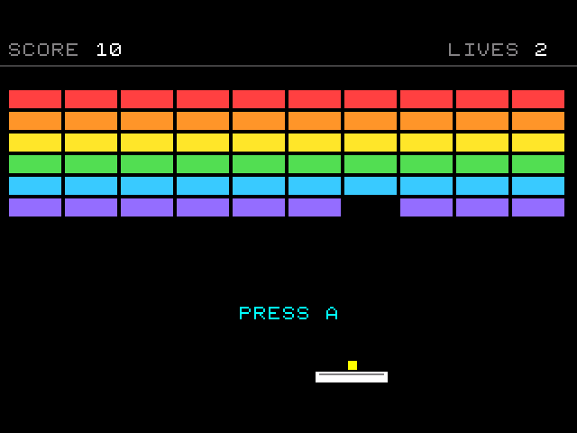
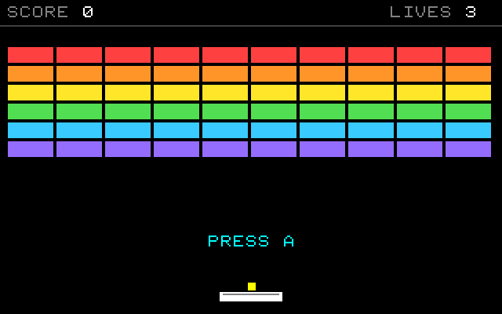
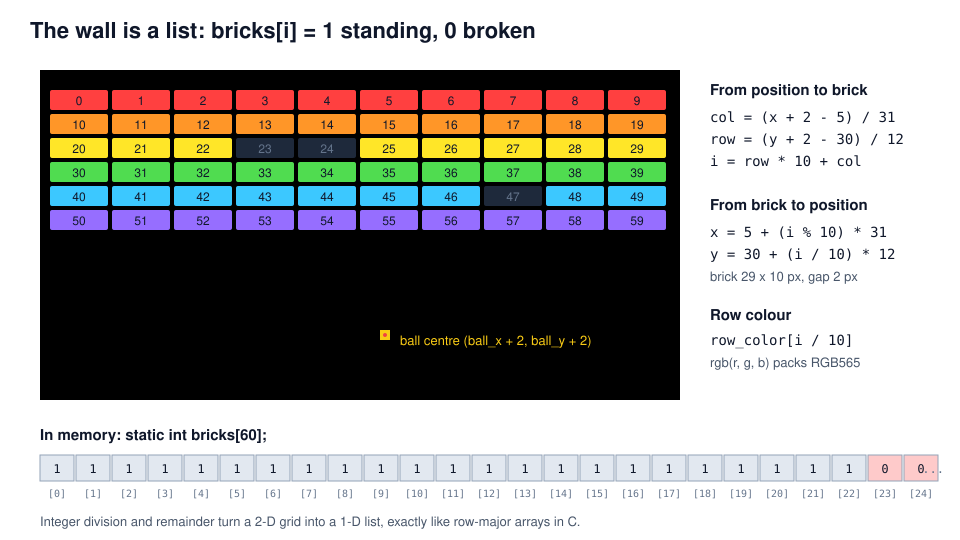
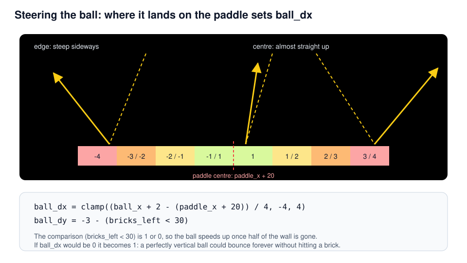
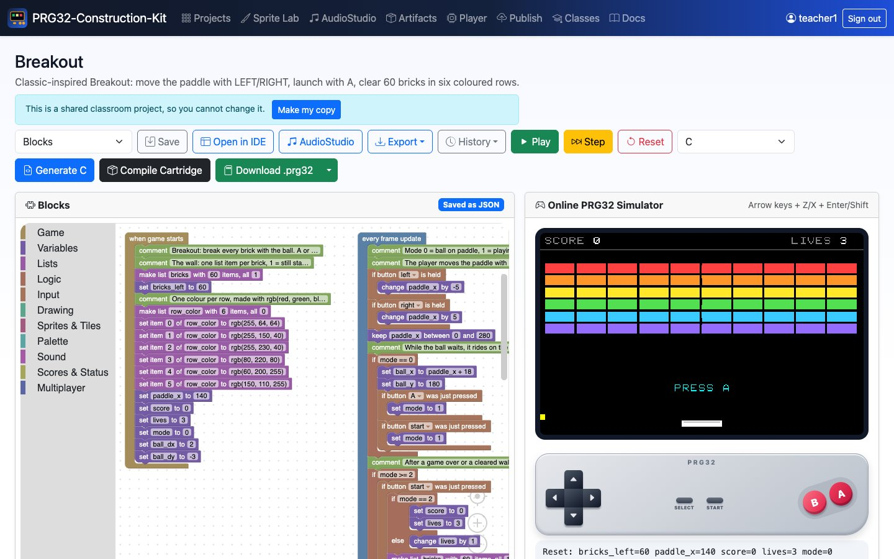
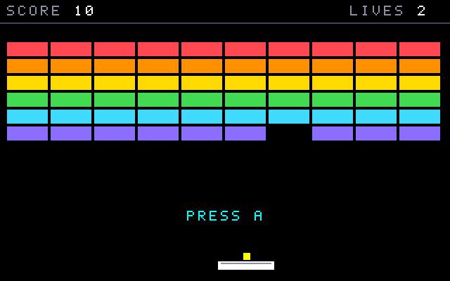

<!-- class: title -->
# Breakout
## Lists as memory: 60 bricks, one ball, and a paddle that aims

PRG32-Construction-Kit tutorial deck, step by step, from blocks to a RISC-V cartridge.



---

## Learning outcomes

1. store a 2-D grid in a **1-D list** and convert between `(column, row)` and an index with `/` and `%`;
2. detect which brick the ball touches with **arithmetic instead of a search loop**;
3. turn a hit position into a **bounce angle** (a simple control input for the player);
4. manage **lives, levels and restarts** with a small state machine;
5. read the generated C: lists become **bounds-checked arrays**.

**Prerequisites:** the Pong tutorial (game loop, velocity, collisions). About 90 minutes.

---

## Context

- Atari's **Breakout** (1976) turned Pong into a single-player game: the second paddle became a wall of bricks. Its prototype hardware is famously associated with Steve Wozniak and Steve Jobs.
- The wall is the first **data structure** of this course: 60 numbers that remember which bricks are still standing.
- Later games (*Arkanoid*, 1986) added power-ups; the core loop stayed the same.

> A brick wall is an array. Breaking a brick is writing a 0 into memory; drawing the wall is reading the memory back.

*Original, classic-inspired reimplementation for teaching; not affiliated with the historical products.*

---

## Rules and controls

<!-- column -->

| Button | Action |
| --- | --- |
| LEFT / RIGHT | move the paddle |
| A or START | launch the ball |
| START | play again |

- Top rows are worth more: 60 points for the top row, 10 for the bottom row.
- Three lives; missing the ball costs one.
- After half of the wall is gone the ball gets faster.
- Clearing the wall gives an extra life and a new wall.

<!-- column -->



---

## The wall is a list



---

## Step 1 - Making the wall

<!-- column -->

<!-- blocks: breakout start "The wall" -->
```text
comment The wall: one list item per brick, 1 = still standing.
make list bricks with 60 items, all 1
set bricks_left to 60
```
<!-- /blocks -->

<!-- blocks: breakout start "One colour per row" -->
```text
comment One colour per row, made with rgb(red, green, blue).
make list row_color with 6 items, all 0
set item 0 of row_color to rgb(255, 64, 64)
set item 1 of row_color to rgb(255, 150, 40)
set item 2 of row_color to rgb(255, 230, 40)
set item 3 of row_color to rgb(80, 220, 80)
set item 4 of row_color to rgb(60, 200, 255)
set item 5 of row_color to rgb(150, 110, 255)
set paddle_x to 140
set score to 0
set lives to 3
set mode to 0
set ball_dx to 2
set ball_dy to -3
```
<!-- /blocks -->

<!-- column -->

- *make list bricks with 60 items, all 1* creates `static int bricks[60]` and fills it.
- `row_color` holds one **RGB565** colour per row. `rgb(255, 64, 64)` packs red, green and blue into 16 bits: 5 + 6 + 5.
- Lists are created in *when game starts* and can be refilled later (a new wall is the same block again).

---

## Step 2 - Paddle and the waiting ball

<!-- column -->

<!-- blocks: breakout update "The player moves" -->
```text
comment The player moves the paddle with LEFT and RIGHT.
if button left is held
    change paddle_x by -5
if button right is held
    change paddle_x by 5
keep paddle_x between 0 and 280
```
<!-- /blocks -->

<!-- blocks: breakout update "While the ball waits" -->
```text
comment While the ball waits, it rides on the paddle; A or START launches it.
if mode == 0
    set ball_x to paddle_x + 18
    set ball_y to 180
    if button a was just pressed
        set mode to 1
    if button start was just pressed
        set mode to 1
```
<!-- /blocks -->

<!-- column -->

In mode 0 the ball is **attached** to the paddle: its position is computed from the paddle, not integrated from a velocity.

Two different *just pressed* blocks can start the same action: A or START.

---

## Step 3 - Ball motion and walls

<!-- blocks: breakout update "Move the ball one step" -->
```text
comment Move the ball one step and bounce on the three walls.
change ball_x by ball_dx
change ball_y by ball_dy
if ball_x < 0
    set ball_x to 0
    set ball_dx to abs(ball_dx)
    play beep freq 300 ms 15
if ball_x > 315
    set ball_x to 315
    set ball_dx to -abs(ball_dx)
    play beep freq 300 ms 15
if ball_y < 18
    set ball_y to 18
    set ball_dy to abs(ball_dy)
    play beep freq 300 ms 15
```
<!-- /blocks -->

---

## Step 4 - Which brick did we hit?

<!-- column -->

<!-- blocks: breakout update "Which brick" -->
```text
comment Which brick is under the centre of the ball?
set col to (ball_x + 2 - 5) / 31
set row to (ball_y + 2 - 30) / 12
if ball_x + 2 >= 5 && ball_y + 2 >= 30 && col < 10 && row < 6
    if bricks[row * 10 + col] == 1
        set item row * 10 + col of bricks to 0
        change bricks_left by -1
        change score by (6 - row) * 10
        set ball_dy to -ball_dy
        play MIDI note 84 - row * 3 on channel 1 for 60 ms
```
<!-- /blocks -->

<!-- column -->

No loop over 60 bricks: integer division finds the **only** brick that can be under the ball's centre.

- Reading `bricks[row * 10 + col]` outside the list gives 0 (the kit checks bounds), so a ball above the wall is safe.
- The guard `ball_x + 2 >= 5 && ...` keeps negative coordinates from rounding towards zero into brick 0.

Speed is at most 4 px per frame and bricks are 10 px tall, so the ball cannot skip a row.

---

## Step 4 - The same step in C

<!-- c: breakout "Which brick" -->
```c
/* Which brick is under the centre of the ball? */
col = (ball_x + 2 - 5) / 31;
row = (ball_y + 2 - 30) / 12;
if (ball_x + 2 >= 5 && ball_y + 2 >= 30 && col < 10 && row < 6) {
    if (prg32_kit_get(bricks, 60, row * 10 + col) == 1) {
        prg32_kit_set(bricks, 60, row * 10 + col, 0);
        bricks_left += -1;
        score += (6 - row) * 10;
        ball_dy = -ball_dy;
        prg32_audio_note(1, 0, 84 - row * 3, 255, 60);
    }
}
```
<!-- /c -->

`prg32_kit_get` and `prg32_kit_set` are three-line helpers written into the same C file: out-of-range reads return 0 and out-of-range writes do nothing.

---

## Step 5 - Aiming with the paddle



---

## Step 5 - Paddle hit in blocks

<!-- blocks: breakout update "Paddle hit" -->
```text
comment Paddle hit: the further from the centre, the steeper the bounce.
if ball_dy > 0
    if rect ball_x ball_y 5 5 touches rect paddle_x 186 40 6
        set ball_dy to -3 - (bricks_left < 30)
        set ball_dx to clamp((ball_x + 2 - (paddle_x + 20)) / 4, -4, 4)
        if ball_dx == 0
            set ball_dx to 1
        play beep freq 520 ms 25
```
<!-- /blocks -->

`clamp(v, low, high)` is a kit function; `(bricks_left < 30)` is a comparison used as a number (1 or 0).

---

## Step 6 - Lives, cleared walls, restart

<!-- class: tight -->

<!-- column -->

<!-- blocks: breakout update "Missing the ball" -->
```text
comment Missing the ball costs a life.
if ball_y > 200
    change lives by -1
    play MIDI note 40 on channel 1 for 400 ms
    if lives > 0
        set mode to 0
        set ball_dx to 2
        set ball_dy to -3
    else
        set mode to 2
```
<!-- /blocks -->

<!-- blocks: breakout update "No bricks left" -->
```text
comment No bricks left: the wall is cleared.
if bricks_left == 0
    set mode to 3
    play MIDI note 88 on channel 1 for 500 ms
```
<!-- /blocks -->

<!-- column -->

<!-- blocks: breakout update "After a game over" -->
```text
comment After a game over or a cleared wall, START plays again.
if mode >= 2
    if button start was just pressed
        if mode == 2
            set score to 0
            set lives to 3
        else
            change lives by 1
        make list bricks with 60 items, all 1
        set bricks_left to 60
        set mode to 0
        set ball_dx to 2
        set ball_dy to -3
```
<!-- /blocks -->

---

<!-- class: tight -->
## Step 7 - Drawing the wall

<!-- column -->

<!-- blocks: breakout draw "Brick i" -->
```text
comment Brick i is drawn at column i % 10 and row i / 10, in its row colour.
repeat with i from 0 to 59
    if bricks[i] == 1
        draw rectangle x 5 + (i % 10) * 31 y 30 + (i / 10) * 12 w 29 h 10 color value row_color[i / 10]
```
<!-- /blocks -->

<!-- column -->

- One *repeat* draws all 60 bricks: `x = 5 + (i % 10) * 31`, `y = 30 + (i / 10) * 12`.
- *draw rectangle ... color value* takes a colour **expression**: `row_color[i / 10]`.
- Broken bricks are simply not drawn: the list is the single source of truth.

<!-- c: breakout "Brick i" -->
```c
/* Brick i is drawn at column i % 10 and row i / 10, in its row colour. */
{
    /* repeat i from 0 to 59 (at most 1024 times) */
    int prg32_kit_step0;
    int prg32_kit_last0 = 59;
    int prg32_kit_count0 = 0;
    for (prg32_kit_step0 = 0; prg32_kit_step0 <= prg32_kit_last0 && prg32_kit_count0 < 1024; ++prg32_kit_step0, ++prg32_kit_count0) {
        i = prg32_kit_step0;
        if (prg32_kit_get(bricks, 60, i) == 1) {
            prg32_gfx_rect(5 + (i % 10) * 31, 30 + (i / 10) * 12, 29, 10, prg32_kit_get(row_color, 6, i / 10));
        }
    }
}
```
<!-- /c -->

---

## Play it in the browser

<!-- column -->



<!-- column -->

1. Dashboard, **Examples**, *Breakout* (complete game), **Add**.
2. **Play**: LEFT/RIGHT, then A to launch.
3. Watch `bricks_left`, `score` and `mode` in the debug line under the screen.
4. **Generate** and find `static int bricks[60];`.

---

<!-- class: shots -->
## Build and run the cartridge

<!-- column -->

**Compile** builds `breakout-esp32c6.prg32` and `breakout-qemu.prg32`; download them from the links in the IDE's **Build** tab.

```bash
python3 -m prg32 qemu upload breakout-qemu.prg32
python3 -m prg32 qemu run
```

PRG32-QT: **Import Cartridge**, or

```bash
prg32qt-headless breakout-qemu.prg32 300 --dump-ppm breakout.ppm
```

<!-- column -->




---

## What the toolchain produced

| Measure | Value |
| --- | --- |
| Blocks | 3 stacks, 122 blocks |
| Generated C | 345 lines |
| RISC-V code (rv32imc) | 4784 bytes |
| Lists | `bricks[60]`, `row_color[6]` |
| Required PRG32 features | `audio`, `sprites` |
| Verified on | simulator, QEMU firmware, PRG32-QT |

An autoplay test in the simulator (`tools/simulate.js` with a scripted player) cleared the wall eleven times in 40 000 frames: the game can always be finished.

---

## Exercises

1. **Hard bricks:** store 2 in the top row and subtract 1 per hit; draw bricks with value 2 darker.
2. **Score multiplier:** double the points while `bricks_left < 10`.
3. **Two balls:** turn `ball_x`, `ball_y`, `ball_dx`, `ball_dy` into lists of 2 and loop over them.
4. **Bigger wall:** 12 columns of 25-px bricks. Which numbers in the formulas change?
5. **Analysis:** why is a ball faster than 10 px per frame a problem for the brick test?

---

## References

- PRG32: <https://github.com/riscv-prg32/PRG32>; PRG32-QT: <https://github.com/riscv-prg32/PRG32-QT>
- Block reference: `docs/blockly.md`; lists and expressions are described there.
- N. Wirth, *Algorithms + Data Structures = Programs*, Prentice-Hall (1976): arrays and index arithmetic.
- R. Nystrom, *Game Programming Patterns* (2014), "Data Locality".
