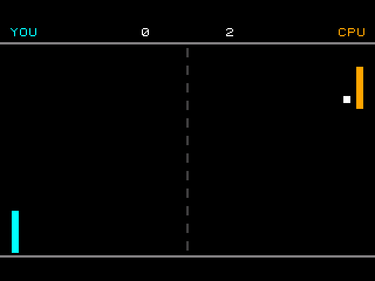
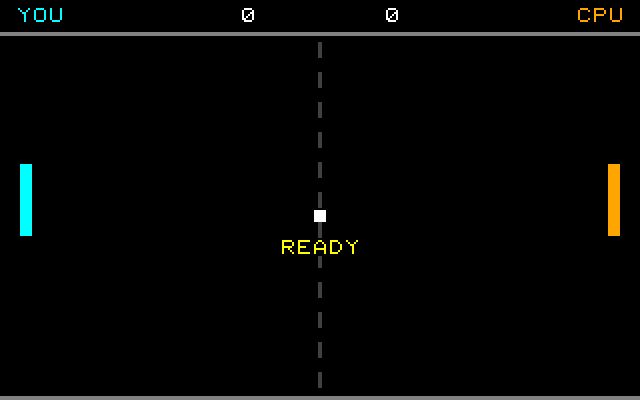
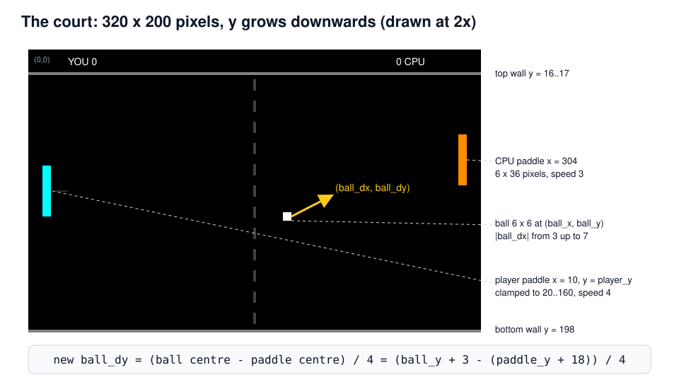
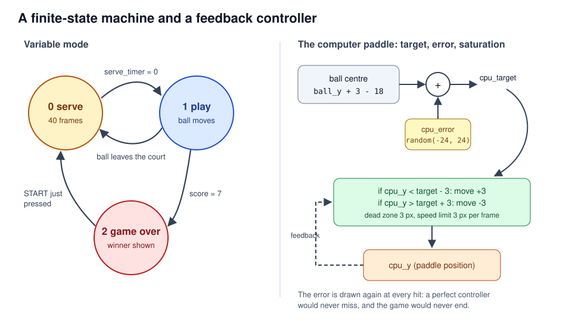
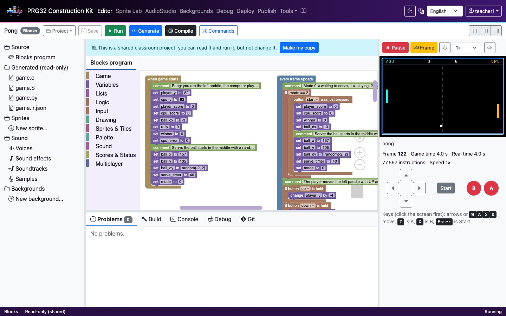
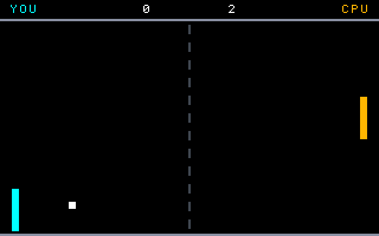

<!-- class: title -->
# Pong
## A first real-time game: state, motion, collision and a feedback controller

PRG32-Construction-Kit tutorial deck, step by step, from blocks to a RISC-V cartridge.



---

## Learning outcomes

By the end of this tutorial you can:

1. describe a video game as a **discrete-time system**: a state that an update rule advances once per frame;
2. use **variables, conditions and comparisons** to model motion and bounces;
3. detect collisions between **axis-aligned rectangles** (AABB);
4. build a computer opponent as a **feedback controller** with saturation and noise;
5. follow the same program from **blocks to IR to C to a PRG32 cartridge**, and run it on QEMU and PRG32-QT.

**Prerequisites:** the first-project tutorial (`docs/tutorials/01_first_project.md`). About 90 minutes.

---

## Why Pong?

- *Tennis for Two* (1958) ran on an analogue computer and an oscilloscope; Atari's **Pong** (1972, engineered by Allan Alcorn) turned the idea into the first commercially successful arcade video game.
- The original had no CPU: its "program" was a circuit of logic chips. Our version is a few hundred lines of C running on a 32-bit RISC-V core.
- Pong is the smallest game that still contains the core ideas of interactive simulation: **state, time step, input, collision, scoring, an opponent**.

> Every element of the court is a rectangle and every rule is an `if`. That makes Pong the "hello world" of game physics.

*This is an original, classic-inspired reimplementation made for teaching; it is not affiliated with the historical products.*

---

## From blocks to cartridge


---

## The game loop


---

## Rules and controls

<!-- column -->

| Button | Action |
| --- | --- |
| UP / DOWN | move your paddle (left) |
| START | play again after a game over |

- The computer plays the right paddle.
- The ball bounces on the top and bottom walls.
- A point is scored when the ball leaves the court; the first to **7** wins.
- The ball gets faster at every paddle hit (up to 7 pixels per frame).

<!-- column -->



---

## The court in numbers



---

## Step 1 - The state

Everything the game remembers lives in **variables**: whole numbers set in *when game starts*.

<!-- column -->

<!-- blocks: pong start -->
```text
when game starts
    comment Pong: you are the left paddle, the computer plays the right paddle.
    set player_y to 82
    set cpu_y to 82
    set player_score to 0
    set cpu_score to 0
    set ball_dx to -3
    set rally to 0
    set winner to 0
    set cpu_error to 0
    comment Serve: the ball starts in the middle with a random slope.
    set ball_x to 157
    set ball_y to 105
    set ball_dy to random(-2, 2)
    set serve_timer to 40
    set mode to 0
```
<!-- /blocks -->

<!-- column -->

- `player_y`, `cpu_y`: the paddle tops.
- `ball_x`, `ball_y`: the ball position; `ball_dx`, `ball_dy`: its **velocity** in pixels per frame.
- `mode`: which phase of the game we are in.
- The *serve* comment group is reused after every point.

In C, each variable becomes a `static int` and `pong_init` gives it its first value.

---

## Step 2 - Modes: a finite-state machine



---

## Step 2 - Modes in blocks

<!-- blocks: pong update "Mode 0" -->
```text
comment Mode 0 = waiting to serve, 1 = playing, 2 = game over.
if mode == 2
    if button start was just pressed
        set player_score to 0
        set cpu_score to 0
        set winner to 0
        set ball_dx to -3
        comment Serve: the ball starts in the middle with a random slope.
        set ball_x to 157
        set ball_y to 105
        set ball_dy to random(-2, 2)
        set serve_timer to 40
        set mode to 0
```
<!-- /blocks -->

*if button START was just pressed* fires **once per press** (edge detection): the kit remembers the buttons of the previous frame.

---

## Step 3 - The player's paddle

<!-- column -->

<!-- blocks: pong update "The player moves" -->
```text
comment The player moves the left paddle with UP and DOWN.
if button up is held
    change player_y by -4
if button down is held
    change player_y by 4
keep player_y between 20 and 160
```
<!-- /blocks -->

<!-- column -->

- *is held* is true on every frame the button is down: 4 pixels per frame is 120 pixels per second.
- *keep ... between* is a **clamp**: the paddle cannot leave the court.

<!-- c: pong "The player moves" -->
```c
/* The player moves the left paddle with UP and DOWN. */
if (input & PRG32_BTN_UP) {
    player_y += -4;
}
if (input & PRG32_BTN_DOWN) {
    player_y += 4;
}
if (player_y < 20) { player_y = 20; }
if (player_y > 160) { player_y = 160; }
```
<!-- /c -->

---

## Step 4 - Moving the ball

<!-- column -->

<!-- blocks: pong update "Move the ball" -->
```text
comment Move the ball one step: new position = old position + velocity.
change ball_x by ball_dx
change ball_y by ball_dy
```
<!-- /blocks -->

<!-- blocks: pong update "Bounce on the top" -->
```text
comment Bounce on the top and bottom walls.
if ball_y < 20
    set ball_y to 20
    set ball_dy to abs(ball_dy)
    play beep freq 440 ms 20
if ball_y > 192
    set ball_y to 192
    set ball_dy to -abs(ball_dy)
    play beep freq 440 ms 20
```
<!-- /blocks -->

<!-- column -->

**Euler integration** with a time step of one frame:

`x(t+1) = x(t) + dx`

A bounce is a **reflection**: the vertical velocity changes sign. Using `abs(ball_dy)` instead of `-ball_dy` is more robust: the ball can never get stuck inside a wall flipping back and forth.

---

## Step 5 - Paddle collisions

<!-- blocks: pong update "Paddle hits" -->
```text
comment Paddle hits: only the paddle the ball is moving towards can hit it.
if ball_dx < 0
    if rect ball_x ball_y 6 6 touches rect 10 player_y 6 36
        set ball_dx to min(abs(ball_dx) + 1, 7)
        comment Where the ball hits the paddle decides the new angle.
        set ball_dy to (ball_y + 3 - (player_y + 18)) / 4
        set rally to rally + 1
        comment The computer guesses where to stand; a bigger guess error makes it miss.
        set cpu_error to random(-24, 24)
        play beep freq 660 ms 40
if ball_dx > 0
    if rect ball_x ball_y 6 6 touches rect 304 cpu_y 6 36
        set ball_dx to -min(abs(ball_dx) + 1, 7)
        comment Where the ball hits the paddle decides the new angle.
        set ball_dy to (ball_y + 3 - (cpu_y + 18)) / 4
        set rally to rally + 1
        comment The computer guesses where to stand; a bigger guess error makes it miss.
        set cpu_error to random(-24, 24)
        play beep freq 660 ms 40
```
<!-- /blocks -->

---

## Step 5 - Collision and angle, explained

<!-- column -->

- *if rect ... touches rect* calls the PRG32 sprite API `prg32_sprite_hitbox`: two rectangles overlap when they overlap on **both** axes.
- Only the paddle the ball is moving **towards** is tested, so the ball cannot be hit twice.
- `min(abs(ball_dx) + 1, 7)` speeds the ball up but keeps it slower than 7 px: a faster ball could jump over the 6-pixel paddle (**tunnelling**).

<!-- column -->

<!-- c: pong "Where the ball hits" -->
```c
/* Where the ball hits the paddle decides the new angle. */
ball_dy = (ball_y + 3 - (player_y + 18)) / 4;
rally = rally + 1;
```
<!-- /c -->

The farther from the paddle centre the ball lands, the steeper it leaves: the player can aim.

---

## Step 6 - The computer player

<!-- column -->

<!-- blocks: pong update "The computer follows" -->
```text
comment The computer follows the ball only while it is coming towards it.
if ball_dx > 0 && ball_x > 100
    set cpu_target to ball_y + 3 - 18 + cpu_error
else
    set cpu_target to 82
if cpu_y < cpu_target - 3
    change cpu_y by 3
if cpu_y > cpu_target + 3
    change cpu_y by -3
keep cpu_y between 20 and 160
```
<!-- /blocks -->

<!-- column -->

A **proportional controller with saturation**: move towards the target at most 3 px per frame, with a dead zone of 3 px so the paddle does not jitter.

The target includes `cpu_error`, a random offset drawn at every hit. The **difficulty** is a single number: try `random(-10, 10)` (hard) or `random(-40, 40)` (easy).

---

<!-- class: tight -->
## Step 7 - Points and the end of the game

<!-- column -->

<!-- blocks: pong update "A point is scored" -->
```text
comment A point is scored when the ball leaves the court.
if ball_x < -6
    change cpu_score by 1
    set ball_dx to -3
    play MIDI note 48 on channel 1 for 300 ms
    comment Serve: the ball starts in the middle with a random slope.
    set ball_x to 157
    set ball_y to 105
    set ball_dy to random(-2, 2)
    set serve_timer to 40
    set mode to 0
if ball_x > 320
    change player_score by 1
    set ball_dx to 3
    play MIDI note 72 on channel 1 for 300 ms
    comment Serve: the ball starts in the middle with a random slope.
    set ball_x to 157
    set ball_y to 105
    set ball_dy to random(-2, 2)
    set serve_timer to 40
    set mode to 0
```
<!-- /blocks -->

<!-- column -->

<!-- blocks: pong update "The first player" -->
```text
comment The first player to reach 7 points wins.
if player_score == 7
    set winner to 1
    set mode to 2
if cpu_score == 7
    set winner to 2
    set mode to 2
```
<!-- /blocks -->

<!-- blocks: pong update "Show the player" -->
```text
comment Show the player's score in the PRG32 status band.
show in status band YOU number player_score
```
<!-- /blocks -->

The status band is the strip the PRG32 firmware draws under the 320 x 200 game area.

---

## Step 8 - Drawing the frame

<!-- column -->

<!-- blocks: pong draw "Painter's algorithm" -->
```text
comment Painter's algorithm: clear, draw the court, then the moving objects on top.
clear screen black
draw rectangle x 0 y 16 w 320 h 2 color gray
draw rectangle x 0 y 198 w 320 h 2 color gray
```
<!-- /blocks -->

<!-- blocks: pong draw "The net" -->
```text
comment The net: a dashed line made of 12 short rectangles.
repeat with dash from 0 to 11
    draw rectangle x 159 y 21 + dash * 15 w 2 h 8 color dark gray
```
<!-- /blocks -->

<!-- column -->

**Painter's algorithm:** draw from back to front; later blocks cover earlier ones.

The dashed net is one *repeat* block: dash `n` is drawn at `y = 21 + n * 15`.

<!-- c: pong "The net" -->
```c
/* The net: a dashed line made of 12 short rectangles. */
{
    /* repeat dash from 0 to 11 (at most 1024 times) */
    int prg32_kit_step0;
    int prg32_kit_last0 = 11;
    int prg32_kit_count0 = 0;
    for (prg32_kit_step0 = 0; prg32_kit_step0 <= prg32_kit_last0 && prg32_kit_count0 < 1024; ++prg32_kit_step0, ++prg32_kit_count0) {
        dash = prg32_kit_step0;
        prg32_gfx_rect(159, 21 + dash * 15, 2, 8, PRG32_COLOR_DARK_GRAY);
    }
}
```
<!-- /c -->

---

<!-- class: tight -->
## Blocks and C side by side

<!-- column -->

<!-- blocks: pong update "Paddle hits" -->
```text
comment Paddle hits: only the paddle the ball is moving towards can hit it.
if ball_dx < 0
    if rect ball_x ball_y 6 6 touches rect 10 player_y 6 36
        set ball_dx to min(abs(ball_dx) + 1, 7)
        comment Where the ball hits the paddle decides the new angle.
        set ball_dy to (ball_y + 3 - (player_y + 18)) / 4
        set rally to rally + 1
        comment The computer guesses where to stand; a bigger guess error makes it miss.
        set cpu_error to random(-24, 24)
        play beep freq 660 ms 40
if ball_dx > 0
    if rect ball_x ball_y 6 6 touches rect 304 cpu_y 6 36
        set ball_dx to -min(abs(ball_dx) + 1, 7)
        comment Where the ball hits the paddle decides the new angle.
        set ball_dy to (ball_y + 3 - (cpu_y + 18)) / 4
        set rally to rally + 1
        comment The computer guesses where to stand; a bigger guess error makes it miss.
        set cpu_error to random(-24, 24)
        play beep freq 660 ms 40
```
<!-- /blocks -->

<!-- column -->

<!-- c: pong "Paddle hits" -->
```c
/* Paddle hits: only the paddle the ball is moving towards can hit it. */
if (ball_dx < 0) {
    if (prg32_sprite_hitbox(ball_x, ball_y, 6, 6, 10, player_y, 6, 36)) {
        ball_dx = prg32_kit_min(prg32_kit_abs(ball_dx) + 1, 7);
        /* Where the ball hits the paddle decides the new angle. */
        ball_dy = (ball_y + 3 - (player_y + 18)) / 4;
        rally = rally + 1;
        /* The computer guesses where to stand; a bigger guess error makes it miss. */
        cpu_error = prg32_kit_random(-24, 24);
        prg32_audio_note(0, 0, prg32_kit_note_from_hz(660), 255, 40);
    }
}
if (ball_dx > 0) {
    if (prg32_sprite_hitbox(ball_x, ball_y, 6, 6, 304, cpu_y, 6, 36)) {
        ball_dx = -prg32_kit_min(prg32_kit_abs(ball_dx) + 1, 7);
        /* Where the ball hits the paddle decides the new angle. */
        ball_dy = (ball_y + 3 - (cpu_y + 18)) / 4;
        rally = rally + 1;
        /* The computer guesses where to stand; a bigger guess error makes it miss. */
        cpu_error = prg32_kit_random(-24, 24);
        prg32_audio_note(0, 0, prg32_kit_note_from_hz(660), 255, 40);
    }
}
```
<!-- /c -->

---

## Play it in the browser

<!-- column -->



<!-- column -->

1. Dashboard, **Examples**, *Pong* (complete game), **Add**.
2. **Play**; use the arrow keys or the on-screen pad.
3. Change a number (paddle speed, `cpu_error`), press **Play** again.
4. **Generate** shows the C above; **Game IR** shows the checked program.

The simulator draws with the same 8 x 8 font and the same RGB565 colours as the firmware.

---

<!-- class: shots -->
## Build and run the cartridge

<!-- column -->

**Compile** builds `pong-esp32c6.prg32` and `pong-qemu.prg32`; download them from the links in the IDE's **Build** tab.

```bash
python3 -m prg32 qemu upload pong-qemu.prg32
python3 -m prg32 qemu run
```

PRG32-QT: **Import Cartridge** and choose either file, or headless:

```bash
prg32qt-headless pong-qemu.prg32 300 --dump-ppm pong.ppm
```

<!-- column -->




---

## What the toolchain produced

| Measure | Value |
| --- | --- |
| Blocks | 3 stacks, 138 blocks |
| Generated C | 349 lines, deterministic |
| RISC-V code (rv32imc) | 4644 bytes, same for `esp32c6` and `qemu` |
| Required PRG32 features | `audio`, `sprites` (auto-detected) |
| Verified on | browser simulator, QEMU firmware, PRG32-QT (`tools/runtime_check.py`) |

The cartridge calls the firmware through the **portable ABI table**, so the same machine code runs on the board and in both emulators.

---

## Exercises

1. **Two players:** replace the computer with the *player 2 up / down* buttons (PRG32 controller bits 8-14).
2. **Difficulty levels:** choose `cpu_error`'s range from a variable set by A (easy) or B (hard) on the title screen.
3. **Speed physics:** what happens if the maximum speed is 9? Explain the result with the paddle width (tunnelling).
4. **Sound design:** play a different MIDI note for wall bounces, paddle hits and points.
5. **Measure:** count frames in a long rally with `frame()`; how many seconds is that at 30 FPS?

**Check your understanding:** why does the bounce use `abs(ball_dy)` rather than `-ball_dy`?

---

## References

- PRG32 project and portable cartridge ABI: <https://github.com/riscv-prg32/PRG32>
- PRG32-QT runtime and debugger: <https://github.com/riscv-prg32/PRG32-QT>
- Construction Kit block reference: `docs/blockly.md`; feature coverage: `docs/prg32_feature_coverage.md`
- R. Nystrom, *Game Programming Patterns*, "Game Loop" and "Update Method" chapters (2014).
- K. Salen, E. Zimmerman, *Rules of Play: Game Design Fundamentals*, MIT Press (2003).
