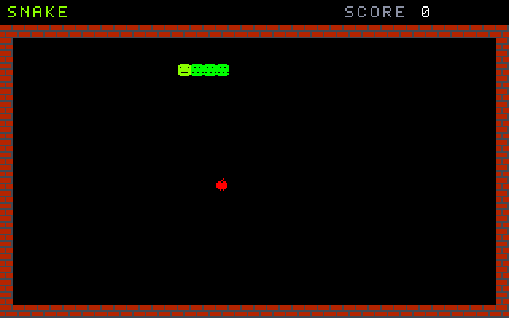
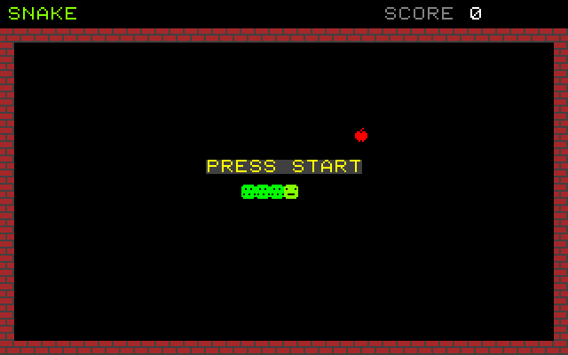
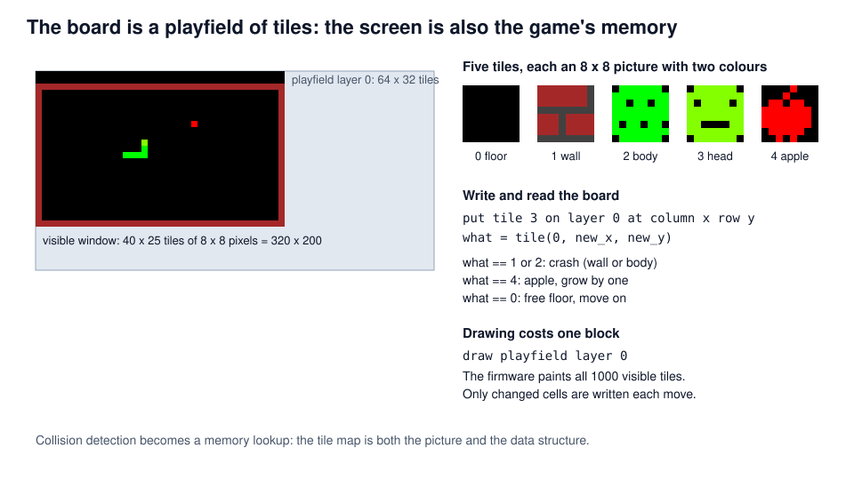
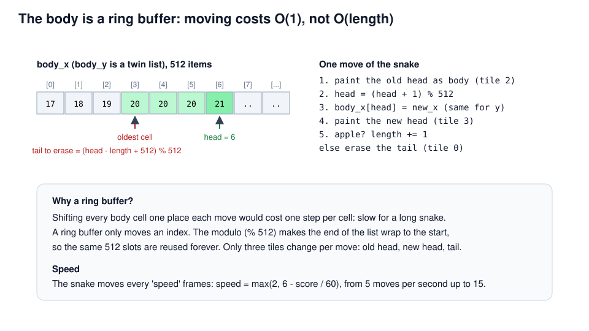
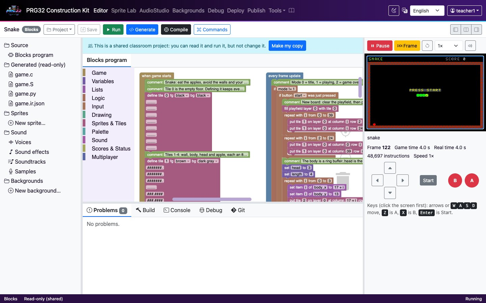
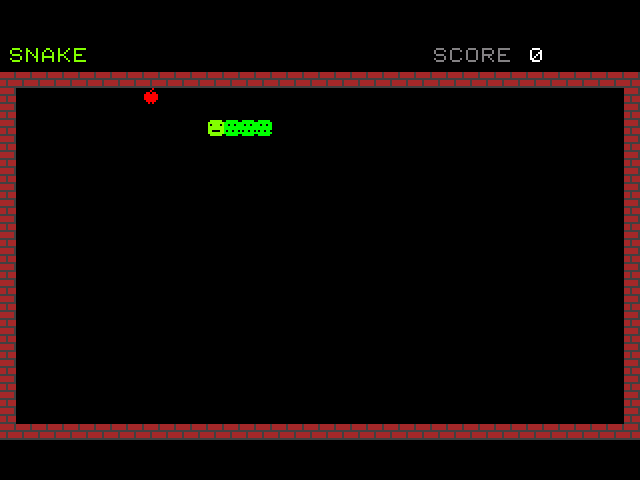

<!-- class: title -->
# Snake
## A grid world: tiles, playfields and a ring buffer

PRG32-Construction-Kit tutorial deck, step by step, from blocks to a RISC-V cartridge.



---

## Learning outcomes

1. design a game on a **discrete grid** where the screen is also the data structure;
2. use the PRG32 **tile and playfield API** (`prg32_tile_define`, `prg32_playfield_put`, `prg32_playfield_get`, `prg32_playfield_draw`);
3. store a growing body in a **ring buffer** with constant-time moves;
4. separate **input timing** (every frame) from **game timing** (one move every N frames);
5. place items with **randomised retries** and reason about their cost.

**Prerequisites:** the Breakout tutorial (lists). About 90 minutes.

---

## Context

- The idea comes from **Blockade** (Gremlin, 1976), a two-player arcade game in which trails became walls.
- It reached hundreds of millions of people as **Snake** on Nokia phones from 1997 (Taneli Armanto's version for the Nokia 6110).
- Snake is a **cellular** game: the world is a grid, time advances in steps, and every rule is a local look-up.

> Tile-based worlds power most 8-bit and 16-bit games. PRG32 provides them in firmware: two playfield layers of 64 x 32 tiles with scrolling.

*Original, classic-inspired reimplementation for teaching; not affiliated with the historical products.*

---

## Rules and controls

<!-- column -->

| Button | Action |
| --- | --- |
| arrows | turn (never straight back) |
| START | start / play again |

- Eat apples to grow by one cell and score 10 points.
- Hitting a wall or your own body ends the game.
- Every 60 points the snake gets faster: from 5 to 15 moves per second.

<!-- column -->



---

## The board is a playfield



---

## Step 1 - Defining tiles

<!-- class: tight -->

<!-- blocks: snake start "Tiles 1-4" -->
```text
comment Tiles 1-4: wall, body, head and apple, each an 8 x 8 picture with two colours.
define tile 1 fg brown bg dark gray
    #######.
    #######.
    #######.
    ........
    ###.####
    ###.####
    ###.####
    ........
define tile 2 fg green bg black
    .######.
    ########
    ##.##.##
    ########
    ########
    #.##.##.
    ########
    .######.
define tile 3 fg lime bg black
    .######.
    ########
    #.####.#
    ########
    ########
    ##....##
    ########
    .######.
define tile 4 fg red bg black
    ....#...
    ...#....
    .##.##..
    #######.
    #######.
    #######.
    .#####..
    ..#.#...
make list body_x with 512 items, all 0
make list body_y with 512 items, all 0
```
<!-- /blocks -->

---

## Step 1 - Tiles, explained

<!-- column -->

<!-- blocks: snake start "Tile 0" -->
```text
comment Tile 0 is the empty floor. Defining it keeps every PRG32 runtime drawing it the same way.
define tile 0 fg black bg black
    ........
    ........
    ........
    ........
    ........
    ........
    ........
    ........
```
<!-- /blocks -->

<!-- column -->

- A tile is an 8 x 8 picture with a foreground and a background colour: eight bytes plus two colours in firmware memory.
- **Tile 0** is the floor. Define it explicitly: the ESP32 firmware paints an undefined tile with black, but other PRG32 runtimes may skip it.
- Tiles are defined once in *when game starts*; the board only stores tile **numbers**.

<!-- c: snake "Tiles 1-4" -->
```c
/* Tiles 1-4: wall, body, head and apple, each an 8 x 8 picture with two colours. */
prg32_tile_define(1, prg32_kit_bitmap_1, PRG32_COLOR_BROWN, PRG32_COLOR_DARK_GRAY);
prg32_tile_define(2, prg32_kit_bitmap_2, PRG32_COLOR_GREEN, PRG32_COLOR_BLACK);
prg32_tile_define(3, prg32_kit_bitmap_3, PRG32_COLOR_LIME, PRG32_COLOR_BLACK);
prg32_tile_define(4, prg32_kit_bitmap_4, PRG32_COLOR_RED, PRG32_COLOR_BLACK);
prg32_kit_fill(body_x, 512, 0);
prg32_kit_fill(body_y, 512, 0);
```
<!-- /c -->

---

## Step 2 - A new board

<!-- column -->

<!-- blocks: snake start "New board" -->
```text
comment New board: clear the playfield, then put wall tiles (1) all around it.
fill playfield layer 0 with tile 0
repeat with i from 0 to 39
    put tile 1 on layer 0 at column i row 2
    put tile 1 on layer 0 at column i row 24
repeat with i from 2 to 24
    put tile 1 on layer 0 at column 0 row i
    put tile 1 on layer 0 at column 39 row i
```
<!-- /blocks -->

<!-- column -->

- *fill playfield* writes tile 0 into all 64 x 32 cells.
- Two *repeat* blocks draw the walls: rows 2 and 24, columns 0 and 39 (the visible board is 40 x 25 tiles).
- Rows 0-1 stay empty for the score.

---

## The body is a ring buffer



---

## Step 3 - The snake and the first apple

<!-- class: tight -->

<!-- column -->

<!-- blocks: snake start "The body is a ring buffer" -->
```text
comment The body is a ring buffer: head is the newest cell, length cells back is the tail.
set head to 3
set length to 4
repeat with i from 0 to 3
    set item i of body_x to 17 + i
    set item i of body_y to 13
    put tile 2 on layer 0 at column 17 + i row 13
put tile 3 on layer 0 at column 20 row 13
set dir_x to 1
set dir_y to 0
set next_x to 1
set next_y to 0
set score to 0
set move_timer to 0
set speed to 6
```
<!-- /blocks -->

<!-- column -->

<!-- blocks: snake start "Try random cells" depth 2 -->
```text
comment Try random cells until an empty one is found.
set placed to 0
repeat with attempt from 1 to 200
    if placed == 0
        ...
set mode to 0
```
<!-- /blocks -->

Random retries are simple and almost always fast: with an empty board nearly every try succeeds. The *repeat* stops after 200 tries, so a full board can never freeze the game.

---

## Step 4 - Steering

<!-- column -->

<!-- blocks: snake update "Turning is allowed" -->
```text
comment Turning is allowed only sideways: the snake cannot reverse into itself.
if button left is held
    if dir_x == 0
        set next_x to -1
        set next_y to 0
if button right is held
    if dir_x == 0
        set next_x to 1
        set next_y to 0
if button up is held
    if dir_y == 0
        set next_x to 0
        set next_y to -1
if button down is held
    if dir_y == 0
        set next_x to 0
        set next_y to 1
```
<!-- /blocks -->

<!-- column -->

- Input is read **every frame**, but the snake moves only every few frames. `next_x`, `next_y` remember the last valid choice until the next move.
- A turn is accepted only across the current direction (`dir_x == 0` for left/right): the snake can never reverse into its own neck.

---

## Step 5 - Timing the moves

<!-- class: tight -->

<!-- blocks: snake update "The snake moves one cell" depth 2 -->
```text
comment The snake moves one cell every 'speed' frames.
change move_timer by 1
if move_timer >= speed
    set move_timer to 0
    set dir_x to next_x
    set dir_y to next_y
    comment Look at the tile in front of the head: a wall or the body ends the game.
    set new_x to body_x[head] + dir_x
    set new_y to body_y[head] + dir_y
    set what to tile(0, new_x, new_y)
    if what == 1 || what == 2
        ...
    else
        ...
```
<!-- /blocks -->

`move_timer` counts frames; at `speed` frames the snake moves one cell. At 30 FPS a speed of 6 is 5 moves per second.

---

## Step 6 - Look before you move

<!-- column -->

<!-- blocks: snake update "Look at the tile" depth 1 -->
```text
comment Look at the tile in front of the head: a wall or the body ends the game.
set new_x to body_x[head] + dir_x
set new_y to body_y[head] + dir_y
set what to tile(0, new_x, new_y)
if what == 1 || what == 2
    ...
else
    ...
```
<!-- /blocks -->

<!-- column -->

`tile(0, new_x, new_y)` reads the playfield: **collision detection is one memory read**, whatever the length of the snake.

<!-- c: snake "Look at the tile" lines 8 -->
```c
/* Look at the tile in front of the head: a wall or the body ends the game. */
new_x = prg32_kit_get(body_x, 512, head) + dir_x;
new_y = prg32_kit_get(body_y, 512, head) + dir_y;
what = prg32_kit_tile(0, new_x, new_y);
if (what == 1 || what == 2) {
    mode = 2;
    prg32_audio_note(1, 0, 36, 255, 600);
    prg32_score_submit_current_player("Snake", score);
...
```
<!-- /c -->

---

## Step 7 - Moving and growing

<!-- class: tight -->

<!-- column -->

<!-- blocks: snake update "Move: the old head" -->
```text
comment Move: the old head becomes body, the new head is stored and drawn.
put tile 2 on layer 0 at column body_x[head] row body_y[head]
set head to (head + 1) % 512
set item head of body_x to new_x
set item head of body_y to new_y
put tile 3 on layer 0 at column new_x row new_y
```
<!-- /blocks -->

<!-- column -->

<!-- blocks: snake update "An apple makes" -->
```text
comment An apple makes the snake longer; otherwise the tail cell is erased.
if what == 4
    change length by 1
    change score by 10
    play MIDI note 60 + length % 12 on channel 1 for 80 ms
    set speed to max(2, 6 - score / 60)
    comment Try random cells until an empty one is found.
    set placed to 0
    repeat with attempt from 1 to 200
        if placed == 0
            set food_x to random(1, 38)
            set food_y to random(3, 23)
            if tile(0, food_x, food_y) == 0
                put tile 4 on layer 0 at column food_x row food_y
                set placed to 1
else
    set tail to (head - length + 512) % 512
    put tile 0 on layer 0 at column body_x[tail] row body_y[tail]
```
<!-- /blocks -->

Only three cells change per move (old head, new head, tail), so the update costs the same for a snake of 4 or 400.

---

## Step 8 - Drawing a whole world with one block

<!-- column -->

<!-- blocks: snake draw "One block draws" -->
```text
comment One block draws the whole board: 40 x 25 tiles of playfield layer 0.
draw playfield layer 0 opaque
```
<!-- /blocks -->

<!-- blocks: snake draw "Text is drawn" -->
```text
comment Text is drawn on top of the tiles.
draw text SNAKE at x 4 y 4 fg lime bg black
draw text SCORE at x 216 y 4 fg gray bg black
draw number score at x 264 y 4 fg white bg black
if mode == 0
    draw text PRESS START at x 116 y 90 fg yellow bg dark gray
if mode == 2
    draw text GAME OVER at x 124 y 80 fg red bg dark gray
    draw text PRESS START at x 116 y 96 fg white bg dark gray
```
<!-- /blocks -->

<!-- column -->

`prg32_playfield_draw` is firmware code: it draws the 1000 visible tiles from the map. The cartridge only keeps the rules.

Text is drawn **after** the tiles (painter's algorithm), on a dark-gray background so it stays readable.

---

## Play it in the browser

<!-- column -->



<!-- column -->

1. Dashboard, **Examples**, *Snake* (complete game), **Add**.
2. **Play**, START, then steer with the arrows.
3. Redraw the apple tile: edit the rows of *define tile 4*.
4. Set `speed` to 2 in *when game starts* for an expert mode.

---

<!-- class: shots -->
## Build and run the cartridge

<!-- column -->

**Compile** builds `snake-esp32c6.prg32` and `snake-qemu.prg32`; download them from the links in the IDE's **Build** tab.

```bash
python3 -m prg32 qemu upload snake-qemu.prg32
python3 -m prg32 qemu run
```

PRG32-QT: **Import Cartridge**, or

```bash
prg32qt-headless snake-qemu.prg32 300 --dump-ppm snake.ppm
```

<!-- column -->




---

## What the toolchain produced

| Measure | Value |
| --- | --- |
| Blocks | 3 stacks, 151 blocks |
| Generated C | 446 lines |
| RISC-V code (rv32imc) | 5120 bytes (+ 4 KiB for the two 512-item lists) |
| Firmware services | tiles and playfield (`tilemap` feature), audio |
| Verified on | simulator, QEMU firmware, PRG32-QT |

PRG32-QT found a portability detail: it skips tiles that were never defined, while the ESP32 firmware paints them black. Defining tile 0 makes the game identical everywhere.

---

## Exercises

1. **Wrap-around arena:** remove the walls and let the snake leave one side and enter on the other.
2. **Obstacles:** add wall tiles at random places each time an apple is eaten.
3. **Two snakes:** a second snake on the *player 2* buttons, with its own ring buffer.
4. **Scrolling world:** make the board 64 x 32 and follow the head with *move playfield camera*.
5. **Analysis:** estimate the average number of retries to place an apple when half the board is full.

---

## References

- PRG32 tiles and playfields (framework manual): <https://github.com/riscv-prg32/PRG32>
- PRG32-QT: <https://github.com/riscv-prg32/PRG32-QT>
- T. H. Cormen et al., *Introduction to Algorithms*, MIT Press: queues and circular buffers.
- Block reference (tiles, playfields, lists): `docs/blockly.md`
