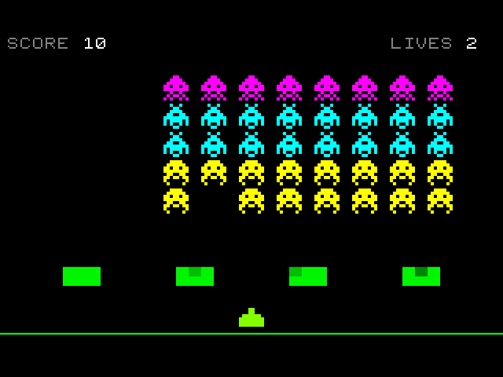
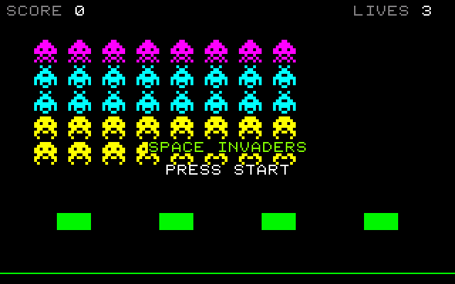
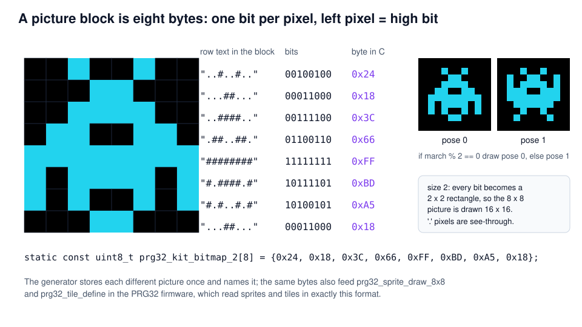
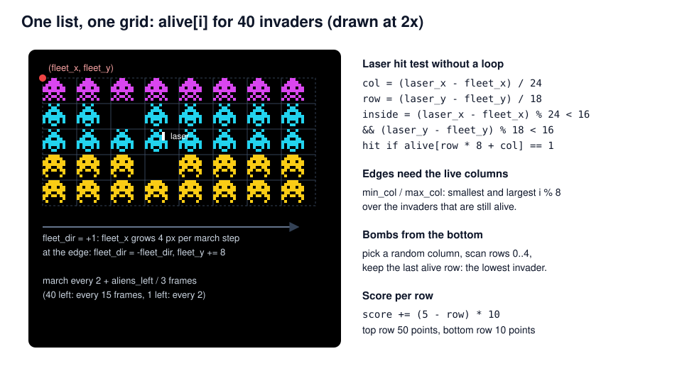
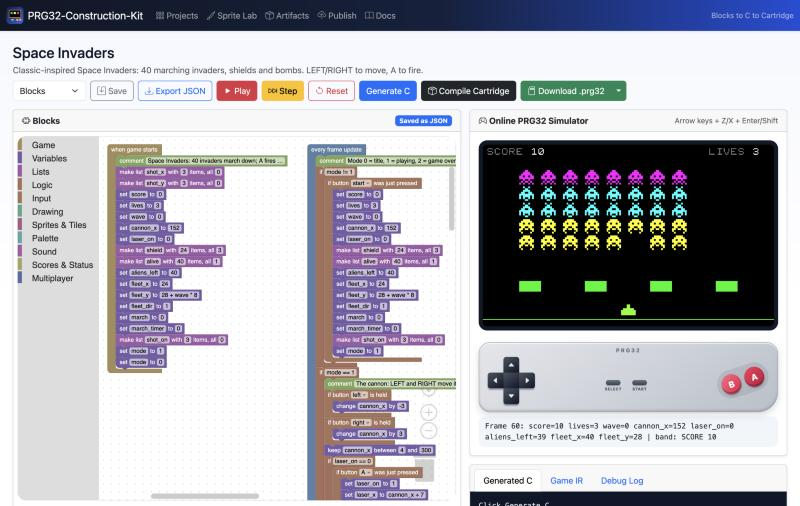
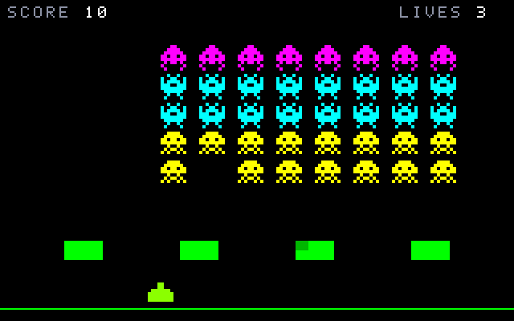

<!-- class: title -->
# Space Invaders
## Pixel pictures, a marching fleet, and many objects at once

PRG32-Construction-Kit tutorial deck, step by step, from blocks to a RISC-V cartridge.



---

## Learning outcomes

1. encode **8 x 8 pictures as bytes** (one bit per pixel) and animate them with two poses;
2. manage a **fleet of 40 objects** with one list and grid arithmetic;
3. design **collective motion**: the whole fleet steps, reverses at the edges and descends;
4. use **object pools** (three bomb slots) instead of creating objects at run time;
5. balance difficulty with **time**: the fleet speeds up as it shrinks.

**Prerequisites:** Pong and Breakout tutorials. About 2 hours.

---

## Context

- **Space Invaders** (Taito, 1978, designed by Tomohiro Nishikado) ran on an Intel 8080 with a 1-bit framebuffer; colours came from cellophane strips on the screen.
- Its famous acceleration was a side effect: with fewer invaders to draw, each frame finished sooner. Here we make it a **design rule**: march every `2 + aliens_left / 3` frames.
- It popularised targets that **shoot back**, shields that wear down, and the high-score chase.

> A 1-bit 8 x 8 picture is eight bytes. The same format is used by the PRG32 firmware for sprites and tiles.

*Original, classic-inspired reimplementation for teaching; not affiliated with the historical products.*

---

## Rules and controls

<!-- column -->

| Button | Action |
| --- | --- |
| LEFT / RIGHT | move the laser cannon |
| A | fire (one laser at a time) |
| START | start / play again |

- 40 invaders in 5 rows: 50 points for the top row, 10 for the bottom rows.
- Up to three bombs fall at once; four shields absorb hits.
- The game ends when lives run out or the invaders reach the ground.
- Each new wave starts lower.

<!-- column -->



---

## Pictures are bytes



---

## Step 1 - Fleet, shields and pools

<!-- column -->

<!-- blocks: space_invaders start -->
```text
when game starts
    comment Space Invaders: 40 invaders march down; A fires the laser cannon.
    make list shot_x with 3 items, all 0
    make list shot_y with 3 items, all 0
    set score to 0
    set lives to 3
    set wave to 0
    set cannon_x to 152
    set laser_on to 0
    make list shield with 24 items, all 3
    make list alive with 40 items, all 1
    set aliens_left to 40
    set fleet_x to 24
    set fleet_y to 28 + wave * 8
    set fleet_dir to 1
    set march to 0
    set march_timer to 0
    make list shot_on with 3 items, all 0
    set mode to 1
    set mode to 0
```
<!-- /blocks -->

<!-- column -->

- `alive[40]`: one item per invader, 1 = alive.
- `shield[24]`: 4 shields x 6 blocks, 3 hit points each.
- `shot_on[3]`, `shot_x[3]`, `shot_y[3]`: **parallel lists** describing three bomb slots. A bomb is "created" by switching a free slot on: no memory is allocated while the game runs.

---

## The fleet as a grid



---

## Step 2 - The cannon and the laser

<!-- class: tight -->

<!-- column -->

<!-- blocks: space_invaders update "The cannon" -->
```text
comment The cannon: LEFT and RIGHT move it, A fires one laser at a time.
if button left is held
    change cannon_x by -3
if button right is held
    change cannon_x by 3
keep cannon_x between 4 and 300
if laser_on == 0
    if button a was just pressed
        set laser_on to 1
        set laser_x to cannon_x + 7
        set laser_y to 172
        play beep freq 1200 ms 30
```
<!-- /blocks -->

<!-- column -->

<!-- blocks: space_invaders update "The laser flies up" depth 1 -->
```text
comment The laser flies up; it can hit an invader or a shield.
if laser_on == 1
    ...
```
<!-- /blocks -->

---

## Step 3 - Hitting an invader

<!-- column -->

<!-- blocks: space_invaders update "Which invader" -->
```text
comment Which invader is the laser inside? Each one sits in a 24 x 18 cell.
set col to (laser_x - fleet_x) / 24
set row to (laser_y - fleet_y) / 18
if laser_x >= fleet_x && laser_y >= fleet_y && col < 8 && row < 5 && (laser_x - fleet_x) % 24 < 16 && (laser_y - fleet_y) % 18 < 16
    if alive[row * 8 + col] == 1
        set item row * 8 + col of alive to 0
        change aliens_left by -1
        change score by (5 - row) * 10
        set laser_on to 0
        play MIDI note 96 on channel 2 for 60 ms
```
<!-- /blocks -->

<!-- column -->

Like the brick test in Breakout, the laser's position is turned into a **cell** with division, and the remainder checks the gap between invaders.

<!-- c: space_invaders "Which invader" -->
```c
/* Which invader is the laser inside? Each one sits in a 24 x 18 cell. */
col = (laser_x - fleet_x) / 24;
row = (laser_y - fleet_y) / 18;
if (laser_x >= fleet_x && laser_y >= fleet_y && col < 8 && row < 5 && (laser_x - fleet_x) % 24 < 16 && (laser_y - fleet_y) % 18 < 16) {
    if (prg32_kit_get(alive, 40, row * 8 + col) == 1) {
        prg32_kit_set(alive, 40, row * 8 + col, 0);
        aliens_left += -1;
        score += (5 - row) * 10;
        laser_on = 0;
        prg32_audio_note(2, 0, 96, 255, 60);
    }
}
```
<!-- /c -->

---

## Step 4 - Shields wear down

<!-- column -->

<!-- blocks: space_invaders update "Shields" -->
```text
comment Shields: 4 shields x 6 blocks, each block 8 x 6 pixels with 3 hit points.
set sx to (laser_x - 40) % 72
set cell to ((laser_x - 40) / 72) * 6 + ((laser_y - 150) / 6) * 3 + sx / 8
if laser_x >= 40 && laser_x < 292 && sx < 24 && laser_y >= 150 && laser_y < 162
    if shield[cell] > 0
        change item cell of shield by -1
        set laser_on to 0
```
<!-- /blocks -->

<!-- column -->

- Shield `k` starts at `x = 40 + 72 k`; inside it, `sx / 8` is the column and `(y - 150) / 6` the row of the 8 x 6 block.
- The same blocks are used for the laser and for bombs: only the "stop the shot" block differs.
- Drawing uses `rgb(0, 80 + shield[i] * 55, 0)`: a damaged block is darker.

---

## Step 5 - The march

<!-- class: tight -->

<!-- column -->

<!-- blocks: space_invaders update "The fleet marches" -->
```text
comment The fleet marches faster when fewer invaders are left.
change march_timer by 1
if march_timer >= 2 + aliens_left / 3
    set march_timer to 0
    change march by 1
    play MIDI note 36 + (march % 4) on channel 0 for 80 ms
    set min_col to 8
    set max_col to -1
    repeat with i from 0 to 39
        if alive[i] == 1
            set min_col to min(min_col, i % 8)
            set max_col to max(max_col, i % 8)
    if (fleet_dir > 0 && fleet_x + max_col * 24 + 16 >= 314) || (fleet_dir < 0 && fleet_x + min_col * 24 <= 4)
        set fleet_dir to -fleet_dir
        change fleet_y by 8
    else
        change fleet_x by fleet_dir * 4
```
<!-- /blocks -->

<!-- column -->

1. Wait `2 + aliens_left / 3` frames (15 frames with 40 invaders, 2 with the last one).
2. Find the leftmost and rightmost **live** columns.
3. At an edge: reverse and drop 8 px; otherwise step 4 px.
4. Play one of four low notes: the march is also a soundtrack.

`march % 2` selects the picture pose, so the invaders "walk" in step with the sound.

---

## Step 6 - Bombs: an object pool

<!-- column -->

<!-- blocks: space_invaders update "Invader bombs" -->
```text
comment Invader bombs: up to 3 at a time, dropped by the lowest invader of a random column.
if random(0, 31) == 0
    set col to random(0, 7)
    set drop_row to -1
    repeat with r from 0 to 4
        if alive[r * 8 + col] == 1
            set drop_row to r
    if drop_row >= 0
        repeat with s from 0 to 2
            if shot_on[s] == 0 && drop_row >= 0
                set item s of shot_on to 1
                set item s of shot_x to fleet_x + col * 24 + 7
                set item s of shot_y to fleet_y + drop_row * 18 + 16
                set drop_row to -1
```
<!-- /blocks -->

<!-- column -->

1. One chance in 32 per frame: `random(0, 31) == 0`.
2. Pick a random column and scan its five rows; the **last** alive row is the lowest invader.
3. Find a free slot (`shot_on[s] == 0`) and switch it on; `drop_row = -1` makes sure only one slot is used.

The pool has a fixed size: at most three bombs, no memory allocation, constant cost per frame.

---

<!-- class: tight -->
## Step 6 - Bombs fall

<!-- blocks: space_invaders update "Bombs fall" depth 3 -->
```text
comment Bombs fall; they can hit a shield or the cannon.
repeat with s from 0 to 2
    if shot_on[s] == 1
        change item s of shot_y by 3
        if shot_y[s] > 196
            ...
        comment Shields: 4 shields x 6 blocks, each block 8 x 6 pixels with 3 hit points.
        set sx to (shot_x[s] - 40) % 72
        set cell to ((shot_x[s] - 40) / 72) * 6 + ((shot_y[s] - 150) / 6) * 3 + sx / 8
        if shot_x[s] >= 40 && shot_x[s] < 292 && sx < 24 && shot_y[s] >= 150 && shot_y[s] < 162
            ...
        if shot_on[s] == 1 && mode == 1
            ...
```
<!-- /blocks -->

The shield test is the same group of blocks as for the laser (Step 4), collapsed here as `...`.

---

## Step 7 - End of the wave, end of the game

<!-- column -->

<!-- blocks: space_invaders update "If the invaders reach" -->
```text
comment If the invaders reach the ground, the game is over.
if fleet_y + 5 * 18 >= 176
    comment Find the lowest row that still has an invader.
    set lowest to -1
    repeat with i from 0 to 39
        if alive[i] == 1
            set lowest to max(lowest, i / 8)
    if fleet_y + lowest * 18 + 16 >= 176
        set mode to 2
        set lives to 0
        save high score score
```
<!-- /blocks -->

<!-- column -->

<!-- blocks: space_invaders update "All invaders gone" -->
```text
comment All invaders gone: a new, lower wave starts.
if aliens_left == 0
    change wave by 1
    if wave > 5
        set wave to 5
    make list alive with 40 items, all 1
    set aliens_left to 40
    set fleet_x to 24
    set fleet_y to 28 + wave * 8
    set fleet_dir to 1
    set march to 0
    set march_timer to 0
    make list shot_on with 3 items, all 0
```
<!-- /blocks -->

*save high score* calls `prg32_score_submit_current_player`: the firmware keeps a score table per game.

---

## Step 8 - Drawing 40 animated invaders

<!-- class: tight -->

<!-- blocks: space_invaders draw "Invader i" depth 4 -->
```text
comment Invader i sits at column i % 8 and row i / 8; two poses make it march.
repeat with i from 0 to 39
    if alive[i] == 1
        set ax to fleet_x + (i % 8) * 24
        set ay to fleet_y + (i / 8) * 18
        if i < 8
            if march % 2 == 0
                ...
            else
                ...
        else
            if i < 24
                ...
            else
                ...
```
<!-- /blocks -->

---

## The pictures in C

<!-- c: space_invaders bitmaps -->
```c
/* ...##...  ..####..  .######.  ##.##.##  ########  ..#..#..  .#.##.#.  #.#..#.# */
static const uint8_t prg32_kit_bitmap_0[8] = {0x18, 0x3C, 0x7E, 0xDB, 0xFF, 0x24, 0x5A, 0xA5};
/* ...##...  ..####..  .######.  ##.##.##  ########  .#.##.#.  #......#  .#....#. */
static const uint8_t prg32_kit_bitmap_1[8] = {0x18, 0x3C, 0x7E, 0xDB, 0xFF, 0x5A, 0x81, 0x42};
/* ..#..#..  ...##...  ..####..  .##..##.  ########  #.####.#  #.#..#.#  ...##... */
static const uint8_t prg32_kit_bitmap_2[8] = {0x24, 0x18, 0x3C, 0x66, 0xFF, 0xBD, 0xA5, 0x18};
/* ..#..#..  #..##..#  #.####.#  ###..###  ########  .######.  ..#..#..  .#....#. */
static const uint8_t prg32_kit_bitmap_3[8] = {0x24, 0x99, 0xBD, 0xE7, 0xFF, 0x7E, 0x24, 0x42};
/* ..####..  .######.  ##.##.##  ########  .##..##.  ##.##.##  #......#  .#....#. */
static const uint8_t prg32_kit_bitmap_4[8] = {0x3C, 0x7E, 0xDB, 0xFF, 0x66, 0xDB, 0x81, 0x42};
/* ..####..  .######.  ##.##.##  ########  ..#..#..  .#.##.#.  #.#..#.#  ........ */
static const uint8_t prg32_kit_bitmap_5[8] = {0x3C, 0x7E, 0xDB, 0xFF, 0x24, 0x5A, 0xA5, 0x00};
/* ...##...  ...##...  .######.  ########  ########  ########  ........  ........ */
static const uint8_t prg32_kit_bitmap_6[8] = {0x18, 0x18, 0x7E, 0xFF, 0xFF, 0xFF, 0x00, 0x00};
```
<!-- /c -->

Each picture block becomes a constant array of eight bytes; the comment above it shows the rows as text. The generator stores identical pictures only once.

---

## Play it in the browser

<!-- column -->



<!-- column -->

1. Dashboard, **Examples**, *Space Invaders* (complete game), **Add**.
2. **Play**, then START; Z fires.
3. Edit a picture block: change a `.` into `#` and watch the invader change at once.
4. **Generate C**: each different picture becomes one `static const uint8_t ...[8]`.

---

<!-- class: shots -->
## Build and run the cartridge

<!-- column -->

**Download .prg32** builds `space-invaders-esp32c6.prg32`; the arrow next to it builds the QEMU file.

```bash
python3 -m prg32 qemu upload space-invaders-qemu.prg32
python3 -m prg32 qemu run
```

PRG32-QT: **Import Cartridge**, or

```bash
prg32qt-headless space-invaders-qemu.prg32 300 --dump-ppm si.ppm
```

<!-- column -->




---

## What the toolchain produced

| Measure | Value |
| --- | --- |
| Blocks | 3 stacks, 194 blocks |
| Generated C | 566 lines, 7 distinct pictures |
| RISC-V code (rv32imc) | 6420 bytes |
| Lists | `alive[40]`, `shield[24]`, `shot_on/x/y[3]` |
| Required PRG32 features | `audio`, `sprites` |
| Verified on | simulator (pixel-identical title screen to the QEMU framebuffer), QEMU, PRG32-QT |

The title screen rendered by the browser simulator and the one read from the QEMU firmware framebuffer differ in **0 of 64 000 pixels**.

---

## Exercises

1. **Mystery ship:** add a UFO that crosses the top row every 20 seconds (`frame() % 600`).
2. **Two lasers:** turn the laser into a pool of two slots, like the bombs.
3. **Shield shapes:** give each shield 12 blocks in a 4 x 3 arch. Which formulas change?
4. **Fairness:** bombs never fall from a column with no invaders. Explain how the *repeat* over rows guarantees it.
5. **Hardware sprites:** replace *draw picture* with *draw 8x8 sprite* and compare the look (no scaling, opaque background).

---

## References

- PRG32 sprite and tile API (`prg32_sprite_draw_8x8`, `prg32_tile_define`): <https://github.com/riscv-prg32/PRG32>
- Block reference, pictures and lists: `docs/blockly.md`
- R. Nystrom, *Game Programming Patterns* (2014), "Object Pool" and "Sequencing Patterns".
- C. Kohler, *Power-Up: How Japanese Video Games Gave the World an Extra Life*, BradyGames (2004).
